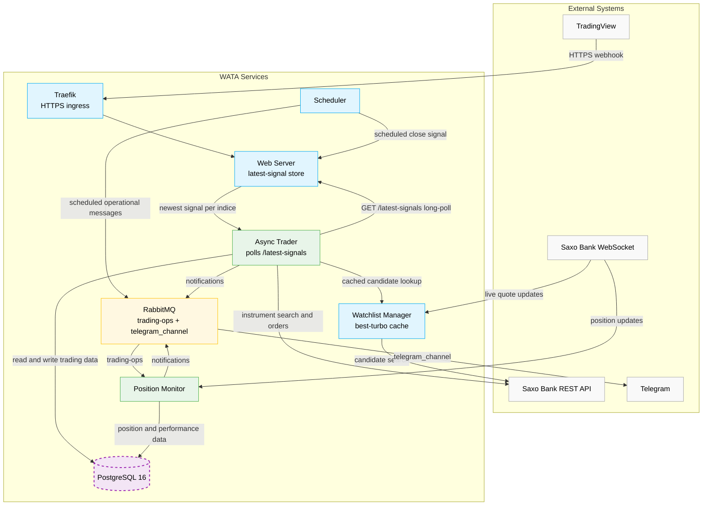

<div align="center">
    <a href="https://ioiti.github.io/wata-docs/">
        
    </a>
    <h1 style="margin-left: 20px; margin-top: 0; margin-bottom: 2;">WATA - Warrants Automated Trading Assistant</h1>
    <p>Automated trading system for Saxo Bank's Knock-out warrants (Turbos), executing trades via webhook signals.</p>
</div>


 


<div align="center">
  <H2><a href="https://ioiti.github.io/wata-docs/docs/intro">📚Documentation Website</a></H2>
</div>

---

> [!WARNING]
> 
> **This is a personal learning project and not production-ready software.**
> 
>  Do not risk money which you are afraid to lose. USE THE SOFTWARE AT YOUR OWN RISK. THE AUTHORS AND ALL AFFILIATES ASSUME NO RESPONSIBILITY FOR YOUR TRADING RESULTS.
>
> Always start by running WATA with small money amounts to test the system and its performance. Use a secondary Saxo account if possible. Understand the risks involved in trading before you start, and do not engage money before you understand how it works and what profit/loss you should expect.
>
> **Risk Warning: WATA CAN LOSE ALL YOUR MONEY due to:**
> - Insufficient code testing
> - Limited security measures on your server
> - Lack of fail-safe mechanisms
> - No comprehensive monitoring included
> - Absence of fail-over systems
> - Limited user experience
> - Change of Saxo Bank API
> - Because trading with leverage is very risky
> 
> *This software is provided "as is" without warranty. The authors accept no liability for any damages arising from its use.*

## 🎯 Purpose

WATA (Warrants Automated Trading Assistant) is an algorithmic trading system compagnon, designed for automated execution of Knock-out warrants (Turbos) on Saxo Bank. It serves as a reliable bridge between trading signals and actual market execution, offering several key benefits:

- **Automated Execution**: Eliminates emotional bias and human error by executing trades based on predefined rules and signals (from TradingView, for example)
- **Risk Management**: Implements systematic position monitoring with stop-loss and take-profit mechanisms
- **Cached Instrument Selection**: Maintains a background watchlist of candidate turbos for configured indices and directions
- **Performance Tracking**: Provides comprehensive analytics and reporting for trade analysis
- **Real-time Monitoring**: Uses Saxo WebSocket updates for open positions and delivers notifications via Telegram
- **Scalability**: Uses asynchronous services, PostgreSQL, and a microservice architecture

The system is particularly suited for traders who:
- Want to automate their trading strategies
- Need reliable execution of trading signals
- Require comprehensive trade tracking and analysis
- Value real-time monitoring and alerts
- Prefer systematic, rule-based trading over discretionary decisions

## 🏗️ Architecture

WATA runs as a set of Docker Compose services:

| Component (role) | Purpose |
|------------------|---------|
| **Traefik** | Routes public webhook traffic over HTTPS, obtains TLS certificates, and applies the configured IP allowlist |
| **Web Server** (`web_server`) | Validates webhook signals and keeps the newest signal per `indice` in an in-memory store |
| **Trader** (`trader`) | Polls the Web Server for signals, applies trading rules, calls Saxo asynchronously, and persists trading data |
| **Watchlist Manager** (`watchlist_manager`) | Builds and refreshes cached best-turbo candidates for configured indices and directions |
| **Position Monitor** (`position_monitor`) | Monitors live Saxo position updates and handles stop-loss, take-profit, trailing-stop, and operational events |
| **Scheduler** (`scheduler`) | Sends scheduled operations to `trading-ops` and scheduled close signals to the Web Server |
| **PostgreSQL** | Primary runtime database for orders, positions, and trade performance |
| **RabbitMQ** | Carries `trading-ops` messages and Telegram notifications; the Trader no longer consumes trade signals from a RabbitMQ queue |
| **Telegram** (`telegram`) | Delivers trade and service notifications |
| **Admin** (`admin`, optional) | Web interface for monitoring, performance reporting, operator actions and editing the trading configuration. Off unless enabled, see [Admin Interface](#️-admin-interface) |
| **Price Recorder** (`price_recorder`, optional) | Keeps ten-second bid and ask bars of the turbos the Trader could buy and of their index, for backtesting. Off unless enabled, see [Price Recorder](#️-price-recorder) |



## 📊 Trading Workflow

1. **Signal Reception**
   - Receive webhook traffic through Traefik HTTPS and validate the token and payload schema
   - Keep the newest signal for each `indice` in the Web Server's in-memory store
   - The Trader long-polls `/latest-signals`, so a signal reaches it as soon as it is stored; older signals for an `indice` are ignored
   - Each signal is executed once: the store keeps serving it until a newer one replaces it, and the Trader skips any `signal_uuid` it has already handled
   - After a Trader restart, signals received more than `startup_replay_max_age_seconds` ago (10 s by default) are not replayed

2. **Rule Validation**
   - Verify market hours and timestamp freshness
   - Check allowed indices, duplicate positions, and configured risk limits
   - Use the Watchlist Manager's cached candidates when available and validate instrument eligibility

3. **Trade Execution**
   - Use asynchronous Saxo API calls for instrument search, order calculation, placement, and confirmation
   - Persist orders, positions, and performance data in PostgreSQL

4. **Real-Time Position Monitoring**
   - The Position Monitor consumes Saxo WebSocket updates instead of relying on the old 7-second REST polling loop
   - Evaluate stop-loss, take-profit, and trailing-stop rules; receive scheduled operational events through `trading-ops`
   - Each price update is checked on its own task, always on the latest prices; a slow check or a closure in progress never delays reading the stream
   - Stop-loss checks keep working from the last known state if PostgreSQL is slow or unreachable
   - The database is reconciled with Saxo when a position leaves the stream and every `reconcile_interval_seconds` (30 s by default), not on every update
   - Optionally, a wider sell stop is left at the broker for each new position (`protective_stop`, off by default) so that a Position Monitor outage is survivable

5. **Reporting and Notifications**
   - Generate daily statistics and trade reports, including closed-trade and daily-profit history
   - Send trade and service notifications through the Telegram service


## 💾 Database System

PostgreSQL 16 is the primary runtime database. The application uses an `asyncpg` connection pool and creates its schema on startup.

- **Order tracking**: Orders and execution details
- **Order follow-up**: for each order Saxo accepted, when it left, when Saxo answered and when its position was seen open or closed, or when the service gave up (`order_execution`, written in the background for the admin interface)
- **Position management**: Open and closed positions, including profit/loss data
- **Performance analytics**: Trade performance and daily statistics
- **DuckDB migration**: `src/database/migration.py` imports existing DuckDB data into PostgreSQL. DuckDB is no longer used by the live trading services.

## 🔐 Authentication and Security

### Saxo Bank API Authentication

WATA uses OAuth 2.0 for Saxo Bank API integration:

1. When authenticating, the application send you a URL via Telegram (or logs of container)
2. Open this URL in your browser and log in with your Saxo credentials, and do all the steps to authorize the application (2FA, risk warning, etc.)
3. After authorization, you'll be redirected to a page with a URL containing a `code` parameter
4. Copy the code and run `watasaxoauth` on your server (you will be prompted to enter the code securely)
5. The application completes authentication using this code

**Command Reference**:
- `watasaxoauth`: Run this command and you'll be prompted to enter the authorization code securely (the code won't be visible when typing)
- The authorization code is valid only for a short time (typically a few minutes)

**Troubleshooting**:
- If you receive an invalid/expired code error, repeat the process
- A "Timeout waiting for authorization code" error means the application waited for 5 minutes without receiving the code

Please refer to the [dedicated docs pages for Saxo Authentication](https://ioiti.github.io/wata-docs/docs/saxo-authentication) for more details.

### Webhook Security

WATA uses token-based authentication to secure webhook endpoints:

1. Each webhook request must include a valid token in the URL (e.g., `/webhook?token=YOUR_TOKEN`)
2. This token is securely generated and stored with strong encryption
3. Manage your webhook token with the `watawebtoken` command

**Command Reference**:
- `watawebtoken`: View your current webhook token
- `watawebtoken --new`: Generate a new webhook token
- The command provides instructions on how to use the token in your webhook URL

**Security Features**:
- All tokens are encrypted before storage
- File permissions are restricted to the owner only
- The deployed Traefik route applies an IP allowlist for TradingView webhook traffic

In the Docker Compose deployment, Traefik redirects HTTP to HTTPS and obtains certificates through Let's Encrypt. Configure `API_DOMAIN` and `ACME_EMAIL` in `deploy/.env`, point the domain at the server, and allow inbound ports 80 and 443. HTTPS and the IP allowlist supplement the webhook token; they do not replace it.

## 📖 Detailed How-To Guide

For a comprehensive, step-by-step guide on setting up and using WATA, including:
- Detailed prerequisites and estimated costs
- Setting up Saxo Bank integration
- Configuring Telegram notifications
- Deploying and configuring WATA
- Setting up TradingView webhooks
- Starting and monitoring your trading

Please refer to our detailed [HOW-TO Guide](https://ioiti.github.io/wata-docs/docs/how-to).

## 🚀 Setup & Deployment

### Prerequisites

   - Saxo Bank account with API access
   - Dedicated Ubuntu server (on VPS or local machine)
   - Docker and Docker Compose installed
   - Python 3.12+
   - Ansible (for automated deployment)
   - Telegram bot for notifications
   - _(Optional) TradingView account for webhook signals_

### Detailed Setup

For detailed setup instructions, refer to our [HOW-TO Guide](https://ioiti.github.io/wata-docs/docs/how-to).

### Quick Start

1. **Configure Inventory**
   - Copy the example Ansible inventory file:
     ```bash
     cp deploy/tools/ansible/inventory/inventory_example.ini deploy/tools/ansible/inventory/inventory.ini
     ```
   - Edit `inventory.ini` with your server details

2. **Build Application**
   - Build the package:
     ```bash
     ./package.sh
     ```

3. **Deploy Application**
   - Run the deployment script:
     ```bash
     cd deploy/tools
     ./deploy_app_to_your_server.sh
     ```
   - The script will use Ansible to deploy the application to your server

4. **Configure Application**
   - On the server, set up your credentials in `etc/config.json` (see below in Configuration section)

5. **Manage Application**
   Use the following aliases on your server:
   - `watastart`: Start the application
   - `watastop`: Stop the application
   - `watalogs`: View application logs
   - `watastatus`: Check application status
   - `watasaxoauth`: Launch the secure authorization code submission process
   - `watawebtoken`: View your webhook authentication token
   - `watawebtoken --new`: Generate a new webhook token


### Docker Compose Setup

The current stack is defined in `deploy/docker-compose.yml`; it does not use the old setup service or a separate Compose override. It includes Traefik, PostgreSQL, RabbitMQ, the Web Server, Trader, Scheduler, Telegram, Position Monitor, and Watchlist Manager.

The Compose file uses health checks and service dependencies for PostgreSQL, RabbitMQ, and Traefik. Traefik is the public HTTPS ingress; the other application services communicate over the internal Compose network.

### Configuration

After deployment, you need to set up your configuration:

1. **Configure Environment Variables**
   ```bash
   # Navigate to the deploy directory
   cd /app/deploy
   
   # Copy the example .env file
   cp .env.example .env
   
   # Edit passwords and the public API hostname
   nano .env
   ```
   
   Set `RABBITMQ_PASSWORD`, `ACME_EMAIL`, and `API_DOMAIN`. Also set a strong `POSTGRES_PASSWORD` in `.env`; the Compose file has a fallback if it is omitted, but it should not be used for a real deployment. Point `API_DOMAIN` to the server so Traefik can issue the HTTPS certificate.

2. **Copy the Example Config**
   ```bash
   cp /app/etc/config_example.json /app/etc/config.json
   ```

3. **Update Configuration**
   Edit `/app/etc/config.json` with your specific settings:

   - **Saxo Bank Authentication**
     ```json
     "authentication": {
       "saxo": {
         "app_config_object": {
           "AppName": "your_app_name",
           "AppKey": "your_app_key",
           "AppSecret": "your_app_secret"
         }
       }
     }
     ```

   - **WebServer Security**
     ```json
     "webserver": {
       "persistant": {
         "token_path": "/app/var/lib/web_server/persist_token.json"
       },
       "app_secret": "YOUR_STRONG_SECRET_KEY"
     }
     ```

   - **Telegram Notifications**
     ```json
     "telegram": {
       "bot_token": "your_bot_token",
       "chat_id": "your_chat_id",
       "bot_name": "your_bot_name"
     }
     ```

   - **Trading Rules**
     - `allowed_indices`: Configure allowed trading indices
     - `market_closed_dates`: Set market holidays
     - `day_trading`: Define profit targets and limits

   - **Other Settings**
     - Logging configuration
     - RabbitMQ connection details
     - PostgreSQL DSN and pool sizing (`postgresql`)
     - Saxo streaming refresh, reconnect and reconciliation settings (`trade.config.general.streaming`)
     - Optional broker-side protective stop (`trade.config.position_management.protective_stop`): `percent` must be wider than `stoploss_percent`; verify it in Saxo's simulation environment before enabling it live
     - Cached candidate settings (`trade.config.watchlist_manager`)
     - Signal polling endpoint, long-poll wait (`long_poll_wait_ms`, `0` falls back to polling every `interval_ms`) and startup replay window (`trade.config.signal_polling`)
     - Saxo keep-warm call between signals (`trade.config.general.keep_warm_interval_seconds`, `0` disables it)
     - Optional spending-power cache for order sizing (`trade.config.buying_power.balance_cache_max_age_seconds`, `0` = ask Saxo on every trade)

   The `duckdb` configuration is retained for the one-time migration source and legacy reporting export; it is not the live trading database. See the [v0.6.x migration notes](CHANGELOG.md) for the DuckDB-to-PostgreSQL migration steps.

   For a complete and detailed explanation of all configuration options, please refer to the [CONFIGURATION Guide](https://ioiti.github.io/wata-docs/docs/configuration).

4. **Restart Services**
   ```bash
   watastop
   watastart
   ```

### Usage

For a deployed instance, send TradingView signals to the HTTPS hostname configured by `API_DOMAIN`. The Web Server stores only the newest signal per `indice` in memory; older timestamps for that index are ignored, and pending signals are not persisted across a Web Server restart. The Trader polls this store internally.

Send trading signals to:
```
POST /webhook?token=YOUR_SECRET_TOKEN
```

Payload:
```json
{
  "action": "long",
  "indice": "us100",
  "signal_timestamp": "2023-07-01T12:00:00Z",
  "alert_timestamp": "2023-07-01T12:00:01Z"
}
```

## 🖥️ Admin Interface

An optional web interface for the operator, served on its own domain or on a port of its own:

- **Dashboard**: the day's profit and loss, trades against the daily limit, whether the next signal would be traded and what holds it back, open positions with their live value, latest signals and the state of each service. The page is updated as things happen and can raise browser notifications. On every page, the top bar says when new entries are paused, when Saxo needs a new authorisation and when a restart is needed.
- **Positions, orders and performance**: history with CSV export, cumulative and daily profit and loss, win rate, long/short and per-instrument figures, read live from PostgreSQL.
- **Each order followed to its position**: the Orders page says what became of every order sent to Saxo (opened a position, closed one, gave none and was cancelled) and how long it took, and a row opens onto each moment: order sent, accepted by Saxo, filled at Saxo, seen by WATA. A position shows the order that opened it and the one that closed it, with a link each way. Three times are worth telling apart:
  - *sent* to *accepted by Saxo* is Saxo's answer to the request, network included;
  - *sent* to *filled at Saxo* is how long Saxo took to fill the order, read on Saxo's clock against the server's, so the two clocks' difference is in it;
  - *accepted* to *seen by WATA* also holds WATA's own waits between two looks (a look at once, then after 0.1 s, 0.2 s, 0.4 s...), so it is an upper bound.

  An order whose position never shows is cancelled once the trader's patience runs out (`trade.config.general.retry_config.max_retries`, about ten seconds at most); the page then gives Saxo's answer to that cancellation. Orders placed before v0.14.0 have none of these moments.
- **Report and exits**: the figures of the daily Telegram report with the account balance over time, and an analysis of how trades ended (by exit, hour of entry, holding time, and how much of the best level was given back).
- **Signals, watchlist and execution timing**: what the Trader did with each signal and why, the turbo that would be bought now, and how long each step of a trade took.
- **Prices**: the bars kept by the [Price Recorder](#️-price-recorder), as a candlestick chart per instrument, from ten-second bars to one-hour ones or as range bars (TradingView's "60R"), with WATA's own entries and exits, the signals received and the index under each turbo. The times that were not recorded are listed, and the bars can be exported to CSV.
- **Backtests**: a strategy replayed on prices of the past with WATA's own rules, asked for and read from the browser: see the [Strategy Backtester](#-strategy-backtester).
- **Operator actions**: pause and resume new entries, close one position, hand over the Saxo authorization code from the browser (instead of `watasaxoauth` over SSH), send a manual `long` / `short` / close signal, request the daily report. Each one asks for an explicit confirmation, is kept in an audit trail and announced on Telegram.
- **Configuration**: view `config.json` with secrets masked and edit the trading parameters (`trade.rules`, `trade.config`, `reporting`, `logging.level`). A change is checked with the same validator the services use, the previous file is kept as `config.json.bak-<date>` and its trading parameters can be restored, and it takes effect the next time each service starts (run `watastop` then `watastart`).
- **Logs**: the end of each service's log file, filtered by level and text.
- **Light and dark**: the interface follows the system setting of the computer or phone, and a button in the top bar (also on the login page) sets it to always light or always dark; the choice is remembered in that browser.

### Enabling it

1. Point a DNS record for the admin domain at the server.
2. Add to `/app/wata/.env`:
   ```
   COMPOSE_PROFILES=admin
   ADMIN_DOMAIN=admin.yourdomain.com
   ADMIN_ALLOWED_IPS=203.0.113.10/32
   ```
   `ADMIN_ALLOWED_IPS` is a comma-separated list of the addresses allowed to reach it: yours only, not TradingView's.
3. `watastart`, then set the password (at least 12 characters): `wataadminpasswd`. Until a password is set, every login is refused.
4. Recommended: `wataadmintotp` prints a key to add to an authenticator app; a one-time code is then required at each login. `wataadmintotp --disable` removes it.

### Without a domain for it

The interface can use the API domain on a second HTTPS port, with the same certificate. Skip step 1 and add these three lines to `/app/wata/.env`, where `ADMIN_DOMAIN` is the value of `API_DOMAIN`:

```
ADMIN_DOMAIN=api.yourdomain.com
ADMIN_ENTRYPOINT=adminsecure
ADMIN_PORT=0.0.0.0:8443
```

The interface is then at `https://api.yourdomain.com:8443/`, behind the same allowlist. All three lines are needed: with the domain alone, the webhook keeps its route and the interface is not served. `0.0.0.0` publishes the port over IPv4 only, where Traefik sees the address of the caller. Before starting, check that nothing on the server already listens on that port (`ss -lnt | grep 8443`): Traefik would not start.

### From a phone, or any address that changes

An allowlist cannot follow a phone on cellular data. Put your devices on a VPN that ends on the server and allow the VPN's addresses instead: the login page stays closed to everyone else. With [WireGuard](https://www.wireguard.com/), as root on the server:

```bash
apt-get install -y wireguard-tools qrencode
umask 077 && cd /etc/wireguard
wg genkey | tee server.key | wg pubkey > server.pub
cat > wg0.conf <<EOF
[Interface]
Address = 10.77.0.1/24
ListenPort = 51820
PrivateKey = $(cat server.key)
EOF
ufw allow 51820/udp
systemctl enable --now wg-quick@wg0
```

Then for each device, with an address of its own (`10.77.0.2`, `10.77.0.3`...), the public IPv4 address of the server in place of `203.0.113.5` and its IPv6 address in place of `2001:db8::5`:

```bash
umask 077 && cd /etc/wireguard
wg genkey | tee phone.key | wg pubkey > phone.pub
cat >> wg0.conf <<EOF

[Peer]
# phone
PublicKey = $(cat phone.pub)
AllowedIPs = 10.77.0.2/32
EOF
cat > phone.conf <<EOF
[Interface]
PrivateKey = $(cat phone.key)
Address = 10.77.0.2/32

[Peer]
PublicKey = $(cat server.pub)
Endpoint = [2001:db8::5]:51820
AllowedIPs = 203.0.113.5/32
PersistentKeepalive = 25
EOF
wg syncconf wg0 <(wg-quick strip wg0)
qrencode -t ansiutf8 < phone.conf
rm phone.key phone.conf
```

The WireGuard app (iPhone, Mac, Android, Windows) reads the code that `qrencode` draws, or the content of `phone.conf` copied to a file before it is removed. In `.env`, the allowlist is the VPN's range: `ADMIN_ALLOWED_IPS=10.77.0.0/24`.

- The tunnel only carries what the device sends to the server's address, the rest of its traffic is untouched. It can therefore stay on: the app's "On-Demand Activation" switches it on by itself.
- That includes SSH: if WireGuard is stopped on the server, switch the tunnel off on the computer to reach it.
- The device reaches the server by its IPv6 address and the tunnel carries its IPv4 address: this is the form that was seen working, from an iPhone, and it needs IPv6 on the network the device is on. With the IPv4 address in both places and no keepalive, the phone never sent a packet; which of the two differences matters was not established.
- The app shows a tunnel as active whether or not the server answers. `wg show` on the server is what tells: a device that has connected has a "latest handshake".
- To check: with the tunnel off, the interface answers 403, or nothing at all when a firewall of the hosting provider closes the port; with it on, the login page. The audit trail then shows the device's VPN address.
- A lost device: remove its `[Peer]` block from `wg0.conf` and run the `wg syncconf` line again.
- If the hosting provider has a firewall of its own in front of the server, open UDP port 51820 there too. Port 8443 can stay closed there: it is reached inside the tunnel.

### Security model

- Its own Traefik route with HTTPS and its own IP allowlist, on its own domain or on a second port of the API domain, then a password login and, when enabled, a one-time code. Repeated failed logins lock the address out for 15 minutes. Changing the password or the second factor closes open sessions.
- The address used for that lockout and in the audit trail is the one Traefik reports. `admin.trusted_proxy_hosts` (`["traefik"]` by default) names the proxies believed for it; anything else that reaches the admin port is known by its own address.
- The container reads PostgreSQL through connections set to read-only, so that a mistake in a query cannot write anything. This is a safeguard, not a separate database account: it connects as the same user as the trading services. The pause of new entries is the one thing it writes, through a separate connection.
- It mounts only the token directories it needs, the other services' logs read-only, and has no access to Docker: it cannot start, stop or restart anything.
- The configuration editor only ever writes the trading parameters, when saving and when restoring a previous version alike: credentials, infrastructure settings and the `admin` section always stay as they are on the server. Inside the trading sections, the addresses the services connect to and listen on (`trade.config.signal_polling.service_url`, `trade.config.watchlist_manager.service_url`, `api_host` and `api_port`) are refused too.
- Manual signals go through the Web Server like a webhook, so the Trader applies its usual rules to them. A single position is closed by the Position Monitor, on a request that expires after a minute.
- `admin.actions_enabled` and `admin.config_edit_enabled` in `config.json` (both `true` by default) switch the operator actions and the configuration editor off. These two settings cannot be changed from the interface itself.

### Pausing new entries

"Pause new entries" on the dashboard makes the Trader refuse every `long` and `short` signal until entries are resumed. Nothing is closed and nothing is stopped: closing signals, the end-of-day close and the Position Monitor's exits keep working. The pause survives restarts.

### What to keep in mind

- The live value of an open position is what the Position Monitor last saw, published every few seconds (`streaming.live_value_interval_seconds`); the interface shows how old it is.
- The state of the Trader and the Scheduler is read from the start and stop lines of their logs, since they expose nothing to query.
- The signal journal and the account balance curve start with the version that introduced them.

## 🗃️ Price Recorder

Saxo's history goes no finer than one minute. To make a backtest on real prices possible later, WATA can record them itself, every ten seconds, from the day this is switched on. **What is not recorded cannot be fetched afterwards.**

What it records:

- **The turbos the Trader could buy**: the same candidates as its own selection (20 per indice and direction). A turbo stays recorded until the end of the day once it has been a candidate, so the one that was bought has no gap after the index moved on.
- **The index** of each allowed indice.
- **One row per instrument and ten seconds**: open, high, low and close of the bid and of the ask, built from Saxo's one-second stream. A stop-loss touched inside the ten seconds is visible in the low.

It is a separate service with its own Saxo stream and database connections: no trading service uses it, and it cannot slow one down.

### Enabling it

1. In `config.json`, set `trade.config.price_recorder.enabled` to `true`.
2. In `/app/wata/.env`, add `recorder` to the profiles: `COMPOSE_PROFILES=recorder`, or `COMPOSE_PROFILES=admin,recorder` with the admin interface.
3. `watastop`, then `watastart`.
4. Check the index: `wataprices probe --uic 1909050` (the underlying of your indice) says whether Saxo prices it for your account. If it does not, look for one that is, for example `wataprices probe --keywords "US Tech 100"`, and put the entry it prints in `trade.config.price_recorder.instruments`.

When nothing has been recorded for five minutes during trading hours, a Telegram message says so, and another when it resumes. With the admin interface, "Price recorder" is listed with the services.

| Setting (`trade.config.price_recorder`) | Default | Meaning |
|---|---|---|
| `enabled` | `false` | Switches the recording on |
| `instruments` | `[]` | Instruments recorded besides the turbos, as `{"label": "us100", "uic": 4913, "asset_type": "CfdOnIndex"}`. An entry labelled like an indice replaces its index |
| `max_instruments` | `150` | Upper bound of what is recorded at once; beyond it, the turbos seen longest ago are dropped |
| `refresh_interval_seconds` | `300` | How often the candidates are looked for |
| `refresh_rate_ms` | `1000` | Refresh rate asked of Saxo's stream |
| `retention_months` | `0` | `0` keeps everything; otherwise whole months older than this are deleted |
| `alert_after_seconds` | `300` | Silence, during trading hours, after which Telegram is told |

### Reading the data

With the [Admin Interface](#️-admin-interface), the **Prices** page shows what was recorded: choose a period and an instrument, and it draws the bid or the ask as candles of ten seconds to one hour, with the index under a turbo, WATA's entries and exits at their prices, the signals received, and the list of the times in trading hours for which nothing was recorded. A day fits at ten seconds; a longer period needs longer bars (a chart holds at most 12,000 of them).

**Range bars.** "Range" beside the bar lengths shows the same prices as range bars: a bar ends when the price has left a range of the size you set, however long that took.

- The size is typed in ticks, as in TradingView (60R is sixty ticks), or as the price move that makes; the two fields follow each other. Enter, the "Apply" button or leaving the field rebuilds the bars, and "−" / "+" step along 1, 2, 5, 10, 20, 50… ticks. A tick is the smallest step of the recorded prices (0.01 for prices with two decimals). In TradingView it is the tick of the symbol you look at, which may be another size (0.25 on NQ futures, where 60R is 15 points): compare the price move, not the number of ticks.
- "Auto" chooses a size that suits the period. The choice is made once for an instrument, a period and a side, and kept while the page reads the data again; pressing Auto again makes it anew. The page remembers, in the browser, the last size used for the index and the last used for turbos.
- Each bar is shown with when it began and when it ended, to the ten seconds, and how long that was. Where several bars began in the same ten seconds, the chart spaces them a second apart on its axis; the readout, the table and the CSV file give the real times.
- They are built from the ten-second bars of the side shown. Inside ten seconds the order of the high and the low is not recorded: the low is taken first when the ten seconds rose, the high first when they fell. A bar opens where the previous one closed.
- **No bar is made up for a time that was not recorded.** After more than a minute without a bar (a night, a recording gap), the bar in progress ends as it is, the chart leaves one empty slot and a new bar starts at the first price recorded. This is TradingView with "Phantom bars" off.
- Up to 31 days and 12,000 bars at a time; beyond, the page asks for a larger range or a shorter period.

For anything else, three tables in PostgreSQL, created by the recorder:

- `price_instrument`: one row per instrument, with `uic`, `asset_type`, `role` (`turbo` or `underlying`), `indice`, `direction`, `barrier` (the knock-out level) and `issuer`.
- `price_bar_10s`: `ts` (start of the ten seconds, UTC), `instrument_id`, `bid_open/high/low/close`, `ask_open/high/low/close`, `updates` and `delayed_minutes`. One partition per month.
- `price_recorder_coverage`: one row per ten seconds the recorder was running, with `feed_ok`.

How to read a bar:

- `updates = 0` means the quote did not move in those ten seconds: the four values are the quote that was standing.
- **No row** for an instrument means it was not quotable (market closed, turbo knocked out) or that nothing was being recorded. `price_recorder_coverage` tells the two apart: no row there, or `feed_ok = false`, means the prices of that moment are not known.
- A bar opens on the quote that was standing when its ten seconds began, not on the first change inside it.
- `delayed_minutes` is Saxo's own flag: above 0, your account receives that instrument late.

To take a period out, with each instrument's description beside its prices:

```bash
wataprices --from 2026-10-12 --to 2026-10-16 --indice us100
# -> /app/wata/var/lib/price_export/prices_2026-10-12_2026-10-16.csv.gz
```

Days are those of the trading timezone, both included.

### What to keep in mind

- **Size**: about 5,000 rows per instrument and trading day. With 50 to 70 instruments seen in a day, that is roughly 8 to 14 GB a year. Check the free disk space of the server, and set `retention_months` if it is short.
- **Resolution**: inside a bar, the extremes are those of the stream (one second), not of every tick.
- **Not yet run against Saxo**: see the verification status in the changelog. Try it in Saxo's simulation environment first.

## 🧪 Strategy Backtester

WATA can replay a strategy on prices of the past and say what it would have done with it: which entries the Trader would have taken or refused, and where the Position Monitor would have sold.

This is the first part of computing the signals inside WATA instead of TradingView. **Nothing live uses it yet**: TradingView still sends the signals, and no service runs the strategy.

### In the admin interface

With the [Admin Interface](#️-admin-interface) enabled, the **Backtests** page (under Analysis) does it all from the browser:

- **Prices**: which days have prices, by month, and "Fetch these days" for more. The download runs in the background, one at a time, and can be stopped. It is slow: see below. **"Keep the prices up to date"** has the service fetch what is missing by itself, as far back as chosen: the newest days first, a few at a time, **only while the market is closed**, waiting longer each time the source stops answering (half an hour, then twice as long, up to twelve hours). Off until switched on.
- **Turbo**: "Measure on real trades" reads WATA's closed positions and the index at the open and the close of each, and finds the turbo they describe: what was paid, how many index points move it by 1.00, its spread, with the range the leverage could be in and how far the result is from the real trades. Backtests are then made with it instead of the assumed one. It needs the prices of the days WATA traded.
- **New backtest**: the period, the strategy's parameters, the turbo and, **for that run only, other values of WATA's rules** (stop, take-profit, trailing stop, daily target, entry cap, cooldown, trade limit, minimum confidence). The live configuration is not touched. Instead of a strategy, **"The signals WATA received"** replays the signals of WATA's own journal for the period.
- **A run**: what was asked, the days that could not be tested, then for each leverage its figures, the curve of all days, the result of each day, why trades were entered and left and which rules refused entries, and the trades, days and refusals as tables with CSV export. "Run again with changes" starts a new one from it.
- **How far to trust a run**, on its page: where its total stands among **the same days traded with entries at random** (see below), what a trade brings on average, what was won for 1 lost, the longest losing streak, the range the total falls in when the days are drawn again, and how far winning trades fell before they won. A run of fewer than 30 trades or 20 days says so in words.
- **A replay of real signals** is also set **against what WATA really did**: each real trade beside the model's, how far apart their results are, whether they ended the same way, the trades only one of the two made, and the days of both. It is the model that is tested there, not a strategy.
- **Try several values (a sweep)**, from "New backtest": give one setting or two (a parameter of the strategy, a rule) several values, and every combination is replayed in one run. **The last days of the period are held out** (30 % unless said otherwise): the page shows every combination on the days a value may be chosen on, the same combinations on the days held out, and says in words what became of the best one there. A combination is then made a backtest of its own with one button.
- **Where the result comes from**, on a run: its trades by hour of entry, weekday, direction, what they were entered and left on, confidence and holding time, with what each group weighs, and how much of the best level was given back.
- **A trade followed**: a trade in the list leads to the chart of its day, brought into view around it, with **the turbo's result every ten seconds from the entry to the exit** against the stop, the day's target and the trailing stop: why the monitor sold where it did.
- **Fills, and the account**: a wait between a decision and its fill, index points lost on each fill, and a starting capital. With a capital, a run also gives its result **in money, at the size WATA would have given each trade** (its sizing by time of day and by confidence, in whole turbos).
- **Housekeeping**: a run can be named again and tagged, several can be removed at once (the failed ones, or those older than 30 days, in one go), and the list says what the runs and the prices take on disk. A run made with code or prices that have changed since is marked **stale**.
- **A day**: the range bars the strategy saw, with the kernel (green while it rises, red while it falls), the VWAP of the session and its band, and a mark where a trade was entered, left, or refused. The day's trades and refusals are listed under the chart.
- **Compare**: tick up to four finished runs in the list to set their figures side by side, with what each one changed and their curves on one chart.

What it does on the server:

- A backtest is a separate process started by the admin, **at the lowest priority and one at a time**; others wait their turn (ten at most). The admin container is limited to one processor, so the services that trade keep the rest.
- Runs are files under `/app/wata/var/lib/backtests/`, one folder each; prices are under `/app/wata/var/lib/price_history/`. Nothing is written to the database. "Remove" on a run deletes its folder.
- It is on with the admin interface. `"backtests_enabled": false` in the `admin` section of `config.json` switches it off.
- A backtest is not an operator action: it changes nothing that trades, and is neither in the audit trail nor announced on Telegram.
- The measure of the turbo and the replay of real signals **read** the closed positions and the signal journal, through the admin's read-only connection. They write files, like any run.
- Prices take about 5 MB of disk a day (the hourly files as they were fetched, and the ten-second bars): some 400 MB for the 120 days "Keep the prices up to date" goes back by default.

### From the command line

From a checkout of the repository:

```bash
# 1. Fetch the index (US Tech 100, from Dukascopy) for the days wanted
PYTHONPATH=./:src/ python3 -m src.strategy.history.dukascopy --from 2026-09-14 --to 2026-10-12

# 2. Replay the strategy on them
PYTHONPATH=./:src/ python3 -m src.strategy.backtest --from 2026-09-14 --to 2026-10-12

# The same with a parameter changed, and the trades written to files
PYTHONPATH=./:src/ python3 -m src.strategy.backtest --from 2026-09-14 --to 2026-10-12 \
    --set entry_mode=cross_catchup --out var/lib/backtests/catchup

# Signals WATA received (a JSON list: at, action, confidence) instead of a strategy
PYTHONPATH=./:src/ python3 -m src.strategy.backtest --from 2026-09-14 --to 2026-10-12 --signals signals.json

# The turbo measured on closed trades (a JSON list: direction, opened_at, closed_at, open_price, close_price)
PYTHONPATH=./:src/ python3 -m src.strategy.calibration --trades trades.json

# Several values of a rule and of a parameter in one pass, the last 30 % of the days held out
PYTHONPATH=./:src/ python3 -m src.strategy.sweep --from 2026-06-01 --to 2026-10-09 \
    --axis rule:day_profit_target=1,1.7,2.5,4 --axis parameter:kernel_bandwidth=8,15,25
```

- **Fetching is slow and has to be repeated.** Dukascopy's server refuses many requests, and stops answering altogether for a while when it is asked too much (two downloads at the same time are enough). Each run keeps what it got under `var/lib/price_history/`, says which days are incomplete, and stops by itself when nothing is answered any more; the next run only asks for what is missing. A day with a missing hour is never written. Count hours, not minutes, for a month of prices.
- **The rules are those of a configuration**: `--config`, else `WATA_CONFIG_PATH`, else `etc/config_example.json`. Give it your own `config.json` to test with your own stop, targets and hours.
- **`--source`** takes a file or a directory made by `wataprices` instead, to replay prices the [Price Recorder](#️-price-recorder) recorded.
- **`--trace file.csv`** writes one line per range bar (close, kernel, VWAP, band, whether entries were allowed), to compare with a chart.
- **`--baseline 200`** (the default) is how many times the same days are traded with entries at random, to compare; `--baseline 0` leaves that out, `--baseline-seed` draws others.
- **`--fill-delay 30`** fills each decision thirty seconds after the next ten seconds, **`--slippage 1.5`** loses that many index points against the trade on each fill, and **`--capital 10000`** (the default) is the account the result is also given in money for; `--capital 0` gives none.

### What is replayed

- **The strategy** (`kernel_vwap`) is the one of the TradingView script, on one feed: on range bars of the index, a kernel regression of the closes crossing the VWAP of the session is an entry; the reverse cross or the end of the session ends it. Entries wait until the session's prices have spread enough around the VWAP, and are not taken while the market is racing or gapping.
- **WATA's rules**, read from the configuration: market hours and closed dates, the trade limit, the cooldown after a loss, the day's profit cap and loss limit, then the stop, the take-profit, the trailing stop, the daily target and the end-of-day close.
- **A turbo**, because those rules are about a turbo's price, not the index. It is a model: its value is the distance from the index to its knock-out level, bought at the ask and valued at the bid.

| Parameter (`--set name=value`) | Default | Meaning |
|---|---|---|
| `range_points` | `6.0` | Size of the range bars, in index points (60R on a chart with ticks of 0.1) |
| `kernel_bandwidth` | `15` | Range bars the kernel regression looks back on |
| `session_start`, `session_end` | `08:00`, `21:55` | The session, in the trading timezone; the VWAP restarts at its start |
| `min_band_width` | `20.0` | Entries wait until the VWAP's band has been this wide once in the session, in points. `0`: no wait |
| `entry_mode` | `cross` | `cross_catchup` also enters when entries become allowed with the kernel already on one side of the VWAP, once its slope agrees |
| `catchup_max_distance` | `0.0` | A catch-up entry waits while the kernel is further than this from the VWAP. `0`: no limit |
| `vwap_weight` | `updates` | What stands for volume: the number of quote changes in each ten seconds, or `time` (every ten seconds the same) |
| `cooldown_bars` | `0` | Range bars to let pass after an exit before a new entry |
| `fast_bars`, `fast_seconds` | `10`, `10` | A racing market: that many range bars within that many seconds |

### Reading the result

One column per leverage assumed for the turbo (`--points-per-unit`: the index points that move its price by 1.00), then, for each, the trades by reason of entry and of exit and the entries refused by rule. With `--out`, `trades_<leverage>.csv` holds every trade and `days_<leverage>.csv` every day.

Percentages are counted as WATA counts a day: each trade as the whole stake, one result applied on the one before. Position sizing by time of day and by confidence is not applied.

**"Random entries beaten"** is what the total is worth. WATA's exits decide most of a trade: the monitor sells at its stop, or as soon as the day has reached its target, whatever the trade was entered on. So the same days are traded again with a coin and a clock: on each day as many entries as the strategy asked for, each at a moment drawn in the hours it may enter in, long or short by a coin, and only WATA's rules to end them. Two hundred times over, with the same draws from one run to the next. The figure is the share of those that did worse than the strategy. **Near 50 %, the entries have shown nothing the exit rules do not explain**; it takes 95 % or more to say they count for something.

**"90 % of redrawn days"** is where the total falls when the same number of days is drawn again from the days tested: how much it owes to which days there were. It is not given for fewer than five days, and knows nothing of days unlike any of them.

With `--out`, each trade is written with the worst level it went through (`min_performance_percent`) beside its best: what a stop has to leave room for.

**"In money, as WATA sizes"** is the same trades at the size WATA would have given each, on an account that starts with the capital: the share of the account the configuration lets an order use, scaled by the time of day and by the confidence of the entry, in whole turbos with one left unbought. The percentages above it count every trade as the whole stake. Neither fees nor taxes are counted.

**A sweep** prints one line per combination, with its total and its trades on the days a value may be chosen on, then on the days held out. Read the second column before believing the first: the value that did best on a period was chosen because it did best there.

### What to keep in mind

- **The turbo's leverage and spread are assumptions** until they are measured on real trades (the Turbo panel, or `python -m src.strategy.calibration`). That is why the backtest runs with three leverages by default: a conclusion that holds for one only is not a conclusion. Once measured, a run is made for the leverage found and for each end of the range it could be in. The measure itself is rough: the index of the history is another broker's and in dollars, the turbo is quoted in euros, and a line through fewer than thirty trades is a first idea.
- **A total proves nothing by itself.** Read it with the random entries it beat, and with the number of trades and days it rests on.
- **A sweep finds the value that did best, which is not the value that will.** That is what the held-out days are for; on a short period they are a handful of days and say little. A sweep runs on one turbo and without the random entries: make the combination chosen a backtest of its own before acting on it.
- **The money leaves out fees.** Saxo's commission on each order is not counted, nor is a turbo priced other than the one assumed.
- **The model can be wrong, and a replay of real signals says by how much.** Until one has been made on the server, with the journal and the positions of real days, the gap between a backtest and what WATA would really have done is not known.
- **Index points say little.** With the example configuration a position is sold at −15 %, or as soon as the day reaches +1.7 %: a move of 300 points and a move of 20 can end as the same trade.
- **It is a close relative of the TradingView script, not a copy.** One feed instead of the average of three, range bars built from ten-second bars, and a session that ends on the clock.
- **Dukascopy's prices are another broker's**, fetched from an address it does not document. They are for research. A strategy that only works on one broker's prices is fragile.
- **Ten seconds is the resolution.** A decision is acted on at the open of the next ten seconds. A stop crossed inside ten seconds is sold at their worst price, a target at the target and no better.
- **Past results are not future results**, and a parameter chosen because it did best on the period tested will do worse on the next one.
- **Not yet run on a server**: the pages were driven in a browser against the admin application on a development machine, with real backtests on three days of prices. The container's new folders and its processor limit are only checked by tests of the compose file. Open the page for the first time with the market closed. The measure of the turbo, the comparison with real trades and a sweep have only seen made-up trades and three days of prices; their two database reads were run once against the real PostgreSQL, when v0.13.0 was deployed. The unattended download has not run against Dukascopy.

## 📈 Reporting

The [Admin Interface](#️-admin-interface) has a performance page that reads the live PostgreSQL database. WATA also generates trading reports and includes a local visualization dashboard built on Observable Framework:

- Daily/cumulative profit tracking
- Performance analysis by action type
- Win-rate and position duration metrics
- Closed-trade and daily-profit history
- Current account balance and milestone projections in daily reports
- Interactive data exploration


_(yeah, I'm still loosing money... but at least ... I know how much !)_

**Data-source note:** PostgreSQL is the live runtime database, but the current Observable dashboard sync scripts still download the legacy DuckDB file from `/app/wata/var/lib/duckdb/` and export it with the DuckDB CLI. They do not export records written to PostgreSQL after the migration. Treat this dashboard sync as a legacy DuckDB export until a PostgreSQL export path is added; application-generated daily reports use the runtime database.

### Requirements

To use the reporting system, you need:
- Node.js and npm installed
- DuckDB CLI for the existing legacy dashboard export
- Python 3.12+ (with required libraries `./reporting/requirements.txt`)
- Ansible configured with proper inventory (same as deployment stage)

### Setting Up the Dashboard

1. **Run the Setup Script**
   ```bash
   ./reporting/setup_dashboard.sh
   ```
   This script creates a new Observable Framework project in `reporting/trading-dashboard`.

2. **Sync Trading Data**
   ```bash
   ./reporting/sync_reporting_data.sh
   ```
   This script synchronizes your trading data from the server to your local dashboard:
   - Fetches the legacy DuckDB file from your production server
   - Exports the database to Parquet format
   - Generates the necessary JSON files for visualization
   - Copies all data to the Observable Framework project

3. **Start the Dashboard Server**
   ```bash
   ./reporting/start_report_server.sh
   ```
   This launches the development server on port 4321.
   Access the dashboard at: http://localhost:4321

## ❓ Frequently Asked Questions

Here are some of the most common questions about WATA:

### General
- **Is WATA suitable for beginners?**  
  WATA requires understanding of trading concepts, Python, and server management. It's recommended for users with intermediate technical skills.

### Trading
- **What markets can I trade with WATA?**  
  WATA supports trading Knock-out warrants (Turbos) available on Saxo Bank, primarily focusing on major indices.

### Setup
- **What are the minimum server requirements?**  
  A basic VPS with 2GB RAM, 50GB SSD, 2 core CPU should be sufficient for getting started.

For a comprehensive list of questions and answers, please see our detailed [FAQ documentation](https://ioiti.github.io/wata-docs/docs/faq).

## 🤝 Acknowledgements

- [@hootnot](https://github.com/hootnot): [Saxo OpenAPI library](https://github.com/hootnot/saxo_openapi)
- [PostgreSQL](https://www.postgresql.org/), [asyncpg](https://github.com/MagicStack/asyncpg), [HTTPX](https://www.python-httpx.org/), [Observable Framework](https://observablehq.com/framework), [DuckDB](https://duckdb.org/) (migration and legacy reporting), [FastAPI](https://fastapi.tiangolo.com/), [RabbitMQ](https://www.rabbitmq.com/), [Traefik](https://traefik.io/), [Ansible](https://www.ansible.com/)

## 🛠️ Contributors

- [@ioiti](https://github.com/IOITI): Project author and maintainer
- [@hootnot](https://github.com/hootnot): [Saxo OpenAPI library](https://github.com/hootnot/saxo_openapi)

### How to Contribute

We welcome contributions to WATA! Here's how you can help:

1. **Report Issues**: Submit bugs or suggest features via GitHub issues
2. **Submit Pull Requests**: Code improvements, documentation fixes, or new features
3. **Share Feedback**: Let us know how you're using WATA and what could be improved

## 📄 License

MIT License

Copyright (c) 2025 IOITI

## 📚 Documentation Website

WATA have a Docusaurus-based documentation website. The website is hosted on GitHub Pages and can be accessed at [https://ioiti.github.io/wata-docs/](https://ioiti.github.io/wata-docs/).

### Documentation Structure

The documentation is organized into the following sections:

- **Introduction**: Overview of WATA
- **How-To Guide**: Step-by-step instructions for setting up and using WATA
- **Configuration Guide**: Details on how to configure WATA
- **Saxo Authentication**: Guide for authenticating with Saxo Bank's API
- **FAQ**: Frequently asked questions about WATA

### Contributing to Documentation

We welcome contributions to the documentation! If you find any errors or have suggestions for improvements, please submit a pull request or open an issue on [this GitHub repository.](https://github.com/IOITI/wata-docs)
