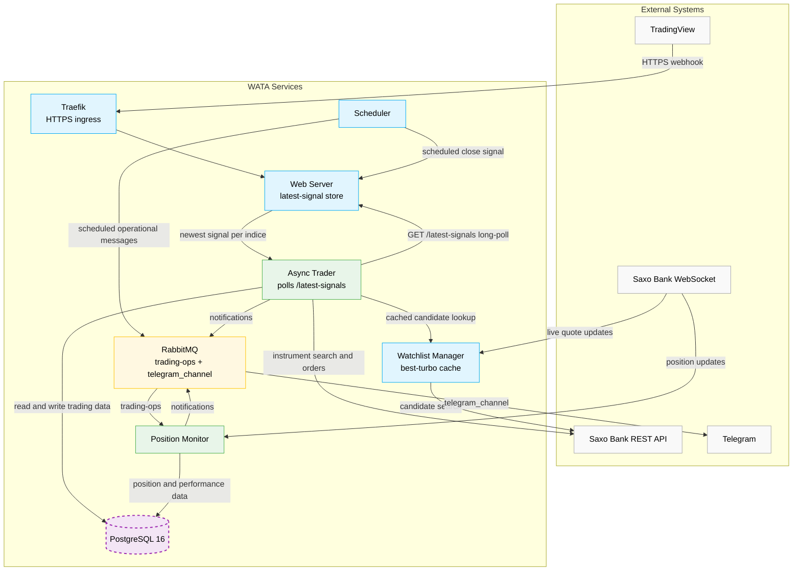
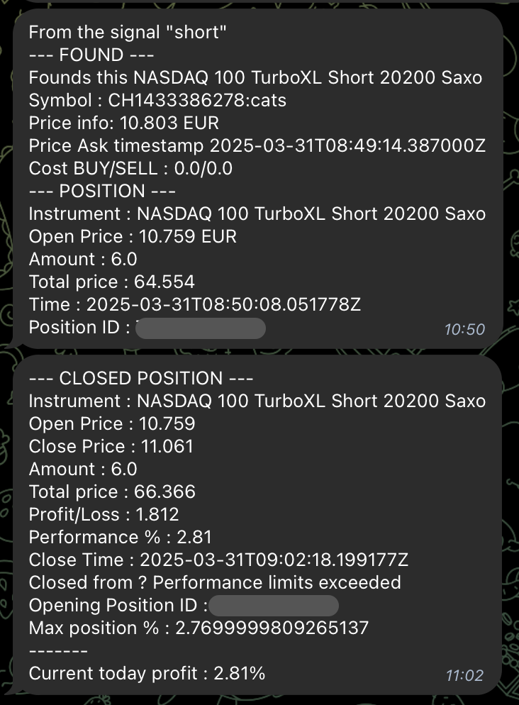

<div align="center">
    <a href="https://ioiti.github.io/wata-docs/">
        
    </a>
    <h1 style="margin-left: 20px; margin-top: 0; margin-bottom: 2;">WATA - Warrants Automated Trading Assistant</h1>
    <p>Automated trading system for Saxo Bank's Knock-out warrants (Turbos), executing trades via webhook signals.</p>
</div>


 


<div align="center">
  <H2><a href="https://ioiti.github.io/wata-docs/docs/intro">📚Documentation Website</a></H2>
</div>

---

> [!WARNING]
> 
> **This is a personal learning project and not production-ready software.**
> 
>  Do not risk money which you are afraid to lose. USE THE SOFTWARE AT YOUR OWN RISK. THE AUTHORS AND ALL AFFILIATES ASSUME NO RESPONSIBILITY FOR YOUR TRADING RESULTS.
>
> Always start by running WATA with small money amounts to test the system and its performance. Use a secondary Saxo account if possible. Understand the risks involved in trading before you start, and do not engage money before you understand how it works and what profit/loss you should expect.
>
> **Risk Warning: WATA CAN LOSE ALL YOUR MONEY due to:**
> - Insufficient code testing
> - Limited security measures on your server
> - Lack of fail-safe mechanisms
> - No comprehensive monitoring included
> - Absence of fail-over systems
> - Limited user experience
> - Change of Saxo Bank API
> - Because trading with leverage is very risky
> 
> *This software is provided "as is" without warranty. The authors accept no liability for any damages arising from its use.*

## 🎯 Purpose

WATA (Warrants Automated Trading Assistant) is an algorithmic trading system compagnon, designed for automated execution of Knock-out warrants (Turbos) on Saxo Bank. It serves as a reliable bridge between trading signals and actual market execution, offering several key benefits:

- **Automated Execution**: Eliminates emotional bias and human error by executing trades based on predefined rules and signals (from TradingView, for example)
- **Risk Management**: Implements systematic position monitoring with stop-loss and take-profit mechanisms
- **Cached Instrument Selection**: Maintains a background watchlist of candidate turbos for configured indices and directions
- **Performance Tracking**: Provides comprehensive analytics and reporting for trade analysis
- **Real-time Monitoring**: Uses Saxo WebSocket updates for open positions and delivers notifications via Telegram
- **Scalability**: Uses asynchronous services, PostgreSQL, and a microservice architecture

The system is particularly suited for traders who:
- Want to automate their trading strategies
- Need reliable execution of trading signals
- Require comprehensive trade tracking and analysis
- Value real-time monitoring and alerts
- Prefer systematic, rule-based trading over discretionary decisions

## 🏗️ Architecture

WATA runs as a set of Docker Compose services:

| Component (role) | Purpose |
|------------------|---------|
| **Traefik** | Routes public webhook traffic over HTTPS, obtains TLS certificates, and applies the configured IP allowlist |
| **Web Server** (`web_server`) | Validates webhook signals and keeps the newest signal per `indice` in an in-memory store |
| **Trader** (`trader`) | Polls the Web Server for signals, applies trading rules, calls Saxo asynchronously, and persists trading data |
| **Watchlist Manager** (`watchlist_manager`) | Builds and refreshes cached best-turbo candidates for configured indices and directions |
| **Position Monitor** (`position_monitor`) | Monitors live Saxo position updates and handles stop-loss, take-profit, trailing-stop, and operational events |
| **Scheduler** (`scheduler`) | Sends scheduled operations to `trading-ops` and scheduled close signals to the Web Server |
| **PostgreSQL** | Primary runtime database for orders, positions, and trade performance |
| **RabbitMQ** | Carries `trading-ops` messages and Telegram notifications; the Trader no longer consumes trade signals from a RabbitMQ queue |
| **Telegram** (`telegram`) | Delivers trade and service notifications |
| **Admin** (`admin`, optional) | Web interface for monitoring, performance reporting, operator actions and editing the trading configuration. Off unless enabled, see [Admin Interface](#️-admin-interface) |
| **Price Recorder** (`price_recorder`, optional) | Keeps ten-second bid and ask bars of the turbos the Trader could buy and of their index, for backtesting. Off unless enabled, see [Price Recorder](#️-price-recorder) |



## 📊 Trading Workflow

1. **Signal Reception**
   - Receive webhook traffic through Traefik HTTPS and validate the token and payload schema
   - Keep the newest signal for each `indice` in the Web Server's in-memory store
   - The Trader long-polls `/latest-signals`, so a signal reaches it as soon as it is stored; older signals for an `indice` are ignored
   - Each signal is executed once: the store keeps serving it until a newer one replaces it, and the Trader skips any `signal_uuid` it has already handled
   - After a Trader restart, signals received more than `startup_replay_max_age_seconds` ago (10 s by default) are not replayed

2. **Rule Validation**
   - Verify market hours and timestamp freshness
   - Check allowed indices, duplicate positions, and configured risk limits
   - Use the Watchlist Manager's cached candidates when available and validate instrument eligibility

3. **Trade Execution**
   - Use asynchronous Saxo API calls for instrument search, order calculation, placement, and confirmation
   - Persist orders, positions, and performance data in PostgreSQL

4. **Real-Time Position Monitoring**
   - The Position Monitor consumes Saxo WebSocket updates instead of relying on the old 7-second REST polling loop
   - Evaluate stop-loss, take-profit, and trailing-stop rules; receive scheduled operational events through `trading-ops`
   - Each price update is checked on its own task, always on the latest prices; a slow check or a closure in progress never delays reading the stream
   - Stop-loss checks keep working from the last known state if PostgreSQL is slow or unreachable
   - The database is reconciled with Saxo when a position leaves the stream and every `reconcile_interval_seconds` (30 s by default), not on every update
   - Optionally, a wider sell stop is left at the broker for each new position (`protective_stop`, off by default) so that a Position Monitor outage is survivable

5. **Reporting and Notifications**
   - Generate daily statistics and trade reports, including closed-trade and daily-profit history
   - Send trade and service notifications through the Telegram service



## 💾 Database System

PostgreSQL 16 is the primary runtime database. The application uses an `asyncpg` connection pool and creates its schema on startup.

- **Order tracking**: Orders and execution details
- **Order follow-up**: for each order Saxo accepted, when it left, when Saxo answered and when its position was seen open or closed, or when the service gave up (`order_execution`, written in the background for the admin interface)
- **Requests to Saxo**: every request sent to Saxo's order endpoint (an order placed, orders cancelled, a protective stop), accepted or not, with what was sent (without the account's keys), why it was sent, and Saxo's answer: its HTTP status, its code, its message, its body as received (`order_request`, written in the background too; nothing trades on it)
- **Position management**: Open and closed positions, including profit/loss data
- **Performance analytics**: Trade performance and daily statistics
- **DuckDB migration**: `src/database/migration.py` imports existing DuckDB data into PostgreSQL. DuckDB is no longer used by the live trading services.

## 🔐 Authentication and Security

### Saxo Bank API Authentication

WATA uses OAuth 2.0 for Saxo Bank API integration:

1. When authenticating, the application send you a URL via Telegram (or logs of container)
2. Open this URL in your browser and log in with your Saxo credentials, and do all the steps to authorize the application (2FA, risk warning, etc.)
3. After authorization, you'll be redirected to a page with a URL containing a `code` parameter
4. Copy the code and run `watasaxoauth` on your server (you will be prompted to enter the code securely)
5. The application completes authentication using this code

**Command Reference**:
- `watasaxoauth`: Run this command and you'll be prompted to enter the authorization code securely (the code won't be visible when typing)
- The authorization code is valid only for a short time (typically a few minutes)

**Troubleshooting**:
- If you receive an invalid/expired code error, repeat the process
- A "Timeout waiting for authorization code" error means the application waited for 5 minutes without receiving the code

Please refer to the [dedicated docs pages for Saxo Authentication](https://ioiti.github.io/wata-docs/docs/saxo-authentication) for more details.

### Webhook Security

WATA uses token-based authentication to secure webhook endpoints:

1. Each webhook request must include a valid token in the URL (e.g., `/webhook?token=YOUR_TOKEN`)
2. This token is securely generated and stored with strong encryption
3. Manage your webhook token with the `watawebtoken` command

**Command Reference**:
- `watawebtoken`: View your current webhook token
- `watawebtoken --new`: Generate a new webhook token
- The command provides instructions on how to use the token in your webhook URL

**Security Features**:
- All tokens are encrypted before storage
- File permissions are restricted to the owner only
- The deployed Traefik route applies an IP allowlist for TradingView webhook traffic

In the Docker Compose deployment, Traefik redirects HTTP to HTTPS and obtains certificates through Let's Encrypt. Configure `API_DOMAIN` and `ACME_EMAIL` in `deploy/.env`, point the domain at the server, and allow inbound ports 80 and 443. HTTPS and the IP allowlist supplement the webhook token; they do not replace it.

### Other ports than 80 and 443

When another program on the server already uses port 80 or 443, Traefik can be published on others, set in `/app/wata/.env` as a number:

```
HTTP_PORT=8080
HTTPS_PORT=4443
```

HTTP is then redirected to `HTTPS_PORT`, and the install script opens both in the firewall at the next deploy (`watastop`, then `watastart`, is enough to apply a change to a running server, with the firewall rule added by hand: `sudo ufw allow 8080/tcp`). Two things outside WATA still need 80 and 443:

- TradingView sends webhooks to ports 80 and 443 only;
- Let's Encrypt checks the domain on port 80 before it gives or renews the certificate.

Another port is therefore only of use behind something that forwards 80 and 443 to it: a router or a cloud firewall's port forwarding, or a reverse proxy that passes TLS through untouched (Traefik's certificate is the one the caller sees). The port of the admin interface on the API domain is `ADMIN_PORT` (see below), and must differ from `HTTPS_PORT`. Inside Docker, the services keep their own ports (web server 80, watchlist manager 8081, admin 8082): they are reached only on WATA's network and conflict with nothing on the server.

## 📖 Detailed How-To Guide

For a comprehensive, step-by-step guide on setting up and using WATA, including:
- Detailed prerequisites and estimated costs
- Setting up Saxo Bank integration
- Configuring Telegram notifications
- Deploying and configuring WATA
- Setting up TradingView webhooks
- Starting and monitoring your trading

Please refer to our detailed [HOW-TO Guide](https://ioiti.github.io/wata-docs/docs/how-to).

## 🚀 Setup & Deployment

### Prerequisites

   - Saxo Bank account with API access
   - Dedicated Ubuntu server (on VPS or local machine)
   - Docker and Docker Compose installed
   - Python 3.12+
   - Ansible (for automated deployment)
   - Telegram bot for notifications
   - _(Optional) TradingView account for webhook signals_

### Detailed Setup

For detailed setup instructions, refer to our [HOW-TO Guide](https://ioiti.github.io/wata-docs/docs/how-to).

### Quick Start

1. **Configure Inventory**
   - Copy the example Ansible inventory file:
     ```bash
     cp deploy/tools/ansible/inventory/inventory_example.ini deploy/tools/ansible/inventory/inventory.ini
     ```
   - Edit `inventory.ini` with your server details

2. **Build Application**
   - Build the package:
     ```bash
     ./package.sh
     ```

3. **Deploy Application**
   - Run the deployment script:
     ```bash
     cd deploy/tools
     ./deploy_app_to_your_server.sh
     ```
   - The script will use Ansible to deploy the application to your server

4. **Configure Application**
   - On the server, set up your credentials in `etc/config.json` (see below in Configuration section)

5. **Manage Application**
   Use the following aliases on your server:
   - `watastart`: Start the application
   - `watastop`: Stop the application
   - `watalogs`: View application logs
   - `watastatus`: Check application status
   - `watasaxoauth`: Launch the secure authorization code submission process
   - `watawebtoken`: View your webhook authentication token
   - `watawebtoken --new`: Generate a new webhook token


### Docker Compose Setup

The current stack is defined in `deploy/docker-compose.yml`; it does not use the old setup service or a separate Compose override. It includes Traefik, PostgreSQL, RabbitMQ, the Web Server, Trader, Scheduler, Telegram, Position Monitor, and Watchlist Manager.

The Compose file uses health checks and service dependencies for PostgreSQL, RabbitMQ, and Traefik. Traefik is the public HTTPS ingress; the other application services communicate over the internal Compose network.

The memory limits are sized for a server of 8 GB, of which WATA uses about 1.25 GB at rest. The two that are reached are the admin's 3 GB (backtests, their Pine runner and Claude's Pine studies, see below) and PostgreSQL's 1.5 GB, with `shared_buffers` 512 MB, `effective_cache_size` 1 GB, `work_mem` 16 MB and a `/dev/shm` of 256 MB, so that the price tables backtests read stay in memory. On a smaller server, lower both in `deploy/docker-compose.yml`. A change to PostgreSQL's restarts the database: make it while the market is closed.

### Configuration

After deployment, you need to set up your configuration:

1. **Configure Environment Variables**
   ```bash
   # Navigate to the deploy directory
   cd /app/deploy
   
   # Copy the example .env file
   cp .env.example .env
   
   # Edit passwords and the public API hostname
   nano .env
   ```
   
   Set `RABBITMQ_PASSWORD`, `ACME_EMAIL`, and `API_DOMAIN`. Also set a strong `POSTGRES_PASSWORD` in `.env`; the Compose file has a fallback if it is omitted, but it should not be used for a real deployment. Point `API_DOMAIN` to the server so Traefik can issue the HTTPS certificate.

2. **Copy the Example Config**
   ```bash
   cp /app/etc/config_example.json /app/etc/config.json
   ```

3. **Update Configuration**
   Edit `/app/etc/config.json` with your specific settings:

   - **Saxo Bank Authentication**
     ```json
     "authentication": {
       "saxo": {
         "app_config_object": {
           "AppName": "your_app_name",
           "AppKey": "your_app_key",
           "AppSecret": "your_app_secret"
         }
       }
     }
     ```

   - **WebServer Security**
     ```json
     "webserver": {
       "persistant": {
         "token_path": "/app/var/lib/web_server/persist_token.json"
       },
       "app_secret": "YOUR_STRONG_SECRET_KEY"
     }
     ```

   - **Telegram Notifications**
     ```json
     "telegram": {
       "bot_token": "your_bot_token",
       "chat_id": "your_chat_id",
       "bot_name": "your_bot_name"
     }
     ```

   - **Trading Rules**
     - `allowed_indices`: Configure allowed trading indices
     - `market_closed_dates`: Set market holidays
     - `day_trading`: Define profit targets and limits
     - `macro_news` (optional, off unless it is there): no new entry around the US releases that move the Nasdaq. From `minutes_before` (5) a release to `minutes_after` (15) it, and to `minutes_after_fomc` (45) after an FOMC statement, whose press conference follows; `events` names which of FOMC, CPI, NFP and PCE. CPI, the jobs report and PCE come out at 08:30 in New York, 14:30 in Paris most of the year; WATA reads New York's hours whatever either side's clocks. With `flatten_minutes_before` (0 unless given), the position monitor also sells what is held from that long before a release until the window ends, and no entry is taken from then: around a release Saxo can stop quoting a turbo for minutes (250 s at the CPI of 14 October 2026), when no stop can be sold. The admin's Configuration page switches it on and off (US releases). The releases come from `src/trade/data/macro_calendar.csv`: past its last day nothing is known and the trader trades on, so from 30 days before it Telegram says so each morning and the admin's health warns; `python -m lab calendar check` says what to add, then deploy.

       ```json
       {"rule_name": "No entry around US releases", "rule_type": "macro_news",
        "rule_config": {"events": ["FOMC", "CPI", "NFP", "PCE"], "minutes_before": 5, "minutes_after": 15, "minutes_after_fomc": 45,
                        "flatten_minutes_before": 10}}
       ```

   - **Other Settings**
     - Logging configuration
     - RabbitMQ connection details
     - PostgreSQL DSN and pool sizing (`postgresql`)
     - Saxo streaming refresh, reconnect and reconciliation settings (`trade.config.general.streaming`)
     - Optional broker-side protective stop (`trade.config.position_management.protective_stop`): `percent` must be wider than `stoploss_percent`; verify it in Saxo's simulation environment before enabling it live
     - Optional `reporting.signal_silence_minutes`: Telegram says when no signal came for that long in trading hours (TradingView's alerts can stop without a word); the admin's Configuration page has it under Market hours and signals
     - Optional `WATA_HEARTBEAT_URL` in `.env`: an outside watcher (a dead-man's switch such as healthchecks.io) the position monitor pings every minute while it hears from Saxo; when the server, its network or its RabbitMQ is down, the watcher alerts by itself
     - Cached candidate settings (`trade.config.watchlist_manager`)
     - Signal polling endpoint, long-poll wait (`long_poll_wait_ms`, `0` falls back to polling every `interval_ms`) and startup replay window (`trade.config.signal_polling`)
     - Saxo keep-warm call between signals (`trade.config.general.keep_warm_interval_seconds`, `0` disables it)
     - Optional spending-power cache for order sizing (`trade.config.buying_power.balance_cache_max_age_seconds`, `0` = ask Saxo on every trade)

   The `duckdb` configuration is retained for the one-time migration source and legacy reporting export; it is not the live trading database. See the [v0.6.x migration notes](CHANGELOG.md) for the DuckDB-to-PostgreSQL migration steps.

   For a complete and detailed explanation of all configuration options, please refer to the [CONFIGURATION Guide](https://ioiti.github.io/wata-docs/docs/configuration).

4. **Restart Services**
   ```bash
   watastop
   watastart
   ```

### Usage

For a deployed instance, send TradingView signals to the HTTPS hostname configured by `API_DOMAIN`. The Web Server stores only the newest signal per `indice` in memory; older timestamps for that index are ignored, and pending signals are not persisted across a Web Server restart. The Trader polls this store internally.

Send trading signals to:
```
POST /webhook?token=YOUR_SECRET_TOKEN
```

Payload:
```json
{
  "action": "long",
  "indice": "us100",
  "signal_timestamp": "2023-07-01T12:00:00Z",
  "alert_timestamp": "2023-07-01T12:00:01Z"
}
```

## 🖥️ Admin Interface

An optional web interface for the operator, served on its own domain or on a port of its own:

- **Dashboard**: the day's profit and loss, trades against the daily limit, whether the next signal would be traded and what holds it back, open positions with their live value, latest signals and the state of each service. The page is updated as things happen and can raise browser notifications. On every page, the top bar says where the page is (Home, the section, the page, and the asset or the backtest it shows, each a link back) and when new entries are paused, when Saxo needs a new authorisation and when a restart is needed.
- **Positions, orders and performance**: history with CSV export, cumulative and daily profit and loss, win rate, long/short and per-instrument figures, read live from PostgreSQL.
- **Each order followed to its position**: the Orders page says what became of every order sent to Saxo (opened a position, closed one, gave none and was cancelled) and how long it took, and a row opens onto each moment: order sent, accepted by Saxo, filled at Saxo, seen by WATA. A position shows the order that opened it and the one that closed it, with a link each way. Three times are worth telling apart:
  - *sent* to *accepted by Saxo* is Saxo's answer to the request, network included;
  - *sent* to *filled at Saxo* is how long Saxo took to fill the order, read on Saxo's clock against the server's, so the two clocks' difference is in it;
  - *accepted* to *seen by WATA* also holds WATA's own waits between two looks (a look at once, then after 0.1 s, 0.2 s, 0.4 s...), so it is an upper bound.

  An order whose position never shows is cancelled once the trader's patience runs out (`trade.config.general.retry_config.max_retries`, about ten seconds at most); the page then gives Saxo's answer to that cancellation. Orders placed before v0.14.0 have none of these moments.
- **Orders Saxo did not take**: a refused order has no id at Saxo, but WATA keeps every request it sends and Saxo's answer (since v0.19.0). The attempts Saxo did not take for one position (or for one signal) are one row among the orders, at its first attempt: "Refused by Saxo ×37", for how long, and for which position. It opens onto what happened, Saxo's answers counted (its message as Saxo wrote it, in the account's language, with its code and the HTTP status), the order that went through after them, and every attempt with what was sent and what came back. The Result filter shows them alone, and the search finds them by the position's id or a word of Saxo's message. The sale that came after them shows the refusals as a step before it. An open position whose sell Saxo does not take says so on the Positions page, under its name; its details list every request about it; and a notice comes up in the admin, at most once a minute for each position. A request Saxo never answered (a timeout) is shown as such: Saxo may have taken the order all the same, and the account at Saxo says whether it did.

  A sale that does not go through is kept by the position monitor until Saxo no longer lists the position: the exits it decides itself, a close asked from the admin, and what the Trader could not sell (a signal's close, the day's close), which the Trader hands over to it. It tries again after 1, 2, 4, 8, then every 15 seconds, every minute after ten minutes and every five after an hour (sooner again once the turbo's price moves), each attempt a request of its own with its own `x-request-id`, and waits for a sale Saxo accepted but has not filled rather than sending another. Telegram says the first failure, then 5, 10 and 15 minutes later, then every half hour, then every hour, and says when the position is no longer open. WATA only sends market orders, so when Saxo accepts nothing but limit orders (in a volatile market, for one), every attempt is refused until it accepts market orders again.
- **What WATA sees of itself**: the Trader and the Position Monitor say every fifteen seconds whether they are alive and what they see, and the System page and the top bar read it: the trader polling the web server or not, its last signal, Saxo refusing to renew its login (no new position is taken then, and the dashboard's "Next entry" says so), the level Saxo serves its session at (below `FullTradingAndChat`, Saxo gives delayed prices: no turbo is bought on a quote Saxo says is delayed); the monitor connected to Saxo's stream or not, positions checked through Saxo's REST API while the stream brings nothing, and the sales it is still trying to make. Telegram says each of these once it matters, directly through Telegram's API when RabbitMQ does not take the message.
- **Nothing held when it should not be**: a minute after the day's close (`close_position_time`), until the next day's start, the position monitor sells what is still held and says so; when the `macro_news` rule gives `flatten_minutes_before`, it sells what is held before a US release. A position Saxo lists that WATA bought but has no record of (a position listed after the Trader gave up looking for it, a service stopped between the order and its record) is recorded again after a minute and managed like the others; one bought by hand is named once on Telegram and left alone. A position WATA sold is recorded with its own reason even when the reconciliation records it first: "SaxoAPI" ("Closed at Saxo") is only what WATA did not sell, a knock-out or a sale by hand.
- **Report and exits**: the figures of the daily Telegram report with the account balance over time, and an analysis of how trades ended (by exit, hour of entry, holding time, and how much of the best level was given back).
- **Signals, watchlist and execution timing**: what the Trader did with each signal and why, the turbo that would be bought now, and how long each step of a trade took.
- **Data: Providers and Assets View**: where the prices WATA keeps come from, and every asset they hold.
  - **Providers** lists the price sources switched on: the [Price Recorder](#️-price-recorder) (Saxo's stream, live) and the [Dukascopy history](#dukascopys-history) (downloaded for backtests), with what each is doing, its assets and the span of its data. Each opens to a page of its own; "Edit configuration" changes the recorder's settings (reviewed, then saved like the Configuration page saves: validated, the previous file kept, audited) or Dukascopy's downloads; "Add provider" switches on one not active yet, Capital.com being shown as to come. Another instrument can be added to either: an index Saxo quotes for the account, recorded beside the turbos, or another index of Dukascopy (the S&P 500, for one), fetched when asked.
  - **Assets View** lists every asset stored, all time or the last days: the turbos and their index from Saxo, the Dukascopy history. It filters by type, provider and status, and marks the turbos Saxo left without a quote today. A click on a row opens it to its last price, its volume, what was recorded of it and the chart of its last day; its name opens its page.
  - **An asset's page** draws its prices as candles from ten seconds to one hour or as range bars (TradingView's "60R"), with WATA's own entries and exits, the signals received and the index under a turbo, the times that were not recorded, and the bars exported to CSV. Its other tabs give each day summed up (open, high, low, close, range, quote changes, share of the trading time covered, volume) and the spread through the day, what is missing from its data, WATA's positions on it, and everything stored about it. Addresses of the former Prices page lead there.
- **Backtests**: a strategy replayed on prices of the past with WATA's own rules, asked for and read from the browser: see the [Strategy Backtester](#-strategy-backtester).
- **Technical Analysis**: Pine Script indicators written, checked and tested in the browser, drawn on WATA's own assets in the Vela charts, and signal rules that let WATA make its own signals from them: see [Technical Analysis](#-technical-analysis).
- **Operator actions**: pause and resume new entries, close one position, hand over the Saxo authorization code from the browser (instead of `watasaxoauth` over SSH), send a manual `long` / `short` / close signal, request the daily report. Each one asks for an explicit confirmation, is kept in an audit trail and announced on Telegram.
- **Configuration**: view `config.json` with secrets masked and edit the trading parameters (`trade.rules`, `trade.config`, `reporting`, `logging.level`). A change is checked with the same validator the services use, the previous file is kept as `config.json.bak-<date>` and its trading parameters can be restored, and it takes effect the next time each service starts (run `watastop` then `watastart`).
- **Logs**: the end of each service's log file, filtered by level and text.
- **Light and dark**: the interface follows the system setting of the computer or phone, and a button in the top bar (also on the login page) sets it to always light or always dark; the choice is remembered in that browser.

### Enabling it

1. Point a DNS record for the admin domain at the server.
2. Add to `/app/wata/.env`:
   ```
   COMPOSE_PROFILES=admin
   ADMIN_DOMAIN=admin.yourdomain.com
   ADMIN_ALLOWED_IPS=203.0.113.10/32
   ```
   `ADMIN_ALLOWED_IPS` is a comma-separated list of the addresses allowed to reach it: yours only, not TradingView's.
3. `watastart`, then set the password (at least 12 characters): `wataadminpasswd`. Until a password is set, every login is refused.
4. Recommended: `wataadmintotp` prints a key to add to an authenticator app; a one-time code is then required at each login. `wataadmintotp --disable` removes it.

### Without a domain for it

The interface can use the API domain on a second HTTPS port, with the same certificate. Skip step 1 and add these three lines to `/app/wata/.env`, where `ADMIN_DOMAIN` is the value of `API_DOMAIN`:

```
ADMIN_DOMAIN=api.yourdomain.com
ADMIN_ENTRYPOINT=adminsecure
ADMIN_PORT=0.0.0.0:8443
```

The interface is then at `https://api.yourdomain.com:8443/`, behind the same allowlist. All three lines are needed: with the domain alone, the webhook keeps its route and the interface is not served. `0.0.0.0` publishes the port over IPv4 only, where Traefik sees the address of the caller. Before starting, check that nothing on the server already listens on that port (`ss -lnt | grep 8443`): Traefik would not start.

### From a phone, or any address that changes

An allowlist cannot follow a phone on cellular data. Put your devices on a VPN that ends on the server and allow the VPN's addresses instead: the login page stays closed to everyone else. With [WireGuard](https://www.wireguard.com/), as root on the server:

```bash
apt-get install -y wireguard-tools qrencode
umask 077 && cd /etc/wireguard
wg genkey | tee server.key | wg pubkey > server.pub
cat > wg0.conf <<EOF
[Interface]
Address = 10.77.0.1/24
ListenPort = 51820
PrivateKey = $(cat server.key)
EOF
ufw allow 51820/udp
systemctl enable --now wg-quick@wg0
```

Then for each device, with an address of its own (`10.77.0.2`, `10.77.0.3`...), the public IPv4 address of the server in place of `203.0.113.5` and its IPv6 address in place of `2001:db8::5`:

```bash
umask 077 && cd /etc/wireguard
wg genkey | tee phone.key | wg pubkey > phone.pub
cat >> wg0.conf <<EOF

[Peer]
# phone
PublicKey = $(cat phone.pub)
AllowedIPs = 10.77.0.2/32
EOF
cat > phone.conf <<EOF
[Interface]
PrivateKey = $(cat phone.key)
Address = 10.77.0.2/32

[Peer]
PublicKey = $(cat server.pub)
Endpoint = [2001:db8::5]:51820
AllowedIPs = 203.0.113.5/32
PersistentKeepalive = 25
EOF
wg syncconf wg0 <(wg-quick strip wg0)
qrencode -t ansiutf8 < phone.conf
rm phone.key phone.conf
```

The WireGuard app (iPhone, Mac, Android, Windows) reads the code that `qrencode` draws, or the content of `phone.conf` copied to a file before it is removed. In `.env`, the allowlist is the VPN's range: `ADMIN_ALLOWED_IPS=10.77.0.0/24`.

- The tunnel only carries what the device sends to the server's address, the rest of its traffic is untouched. It can therefore stay on: the app's "On-Demand Activation" switches it on by itself.
- That includes SSH: if WireGuard is stopped on the server, switch the tunnel off on the computer to reach it.
- The device reaches the server by its IPv6 address and the tunnel carries its IPv4 address: this is the form that was seen working, from an iPhone, and it needs IPv6 on the network the device is on. With the IPv4 address in both places and no keepalive, the phone never sent a packet; which of the two differences matters was not established.
- The app shows a tunnel as active whether or not the server answers. `wg show` on the server is what tells: a device that has connected has a "latest handshake".
- To check: with the tunnel off, the interface answers 403, or nothing at all when a firewall of the hosting provider closes the port; with it on, the login page. The audit trail then shows the device's VPN address.
- A lost device: remove its `[Peer]` block from `wg0.conf` and run the `wg syncconf` line again.
- If the hosting provider has a firewall of its own in front of the server, open UDP port 51820 there too. Port 8443 can stay closed there: it is reached inside the tunnel.

### Security model

- Its own Traefik route with HTTPS and its own IP allowlist, on its own domain or on a second port of the API domain, then a password login and, when enabled, a one-time code. Repeated failed logins lock the address out for 15 minutes. Changing the password or the second factor closes open sessions.
- The address used for that lockout and in the audit trail is the one Traefik reports. `admin.trusted_proxy_hosts` (`["traefik"]` by default) names the proxies believed for it; anything else that reaches the admin port is known by its own address.
- The container reads PostgreSQL through connections set to read-only, so that a mistake in a query cannot write anything. This is a safeguard, not a separate database account: it connects as the same user as the trading services. The pause of new entries is the one thing it writes, through a separate connection.
- It mounts only the token directories it needs, the other services' logs read-only, and has no access to Docker: it cannot start, stop or restart anything.
- The configuration editor only ever writes the trading parameters, when saving and when restoring a previous version alike: credentials, infrastructure settings and the `admin` section always stay as they are on the server. Inside the trading sections, the addresses the services connect to and listen on (`trade.config.signal_polling.service_url`, `trade.config.watchlist_manager.service_url`, `api_host` and `api_port`) are refused too.
- Manual signals go through the Web Server like a webhook, so the Trader applies its usual rules to them. A single position is closed by the Position Monitor, on a request that expires after a minute.
- `admin.actions_enabled` and `admin.config_edit_enabled` in `config.json` (both `true` by default) switch the operator actions and the configuration editor off. These two settings cannot be changed from the interface itself.

### Pausing new entries

"Pause new entries" on the dashboard makes the Trader refuse every `long` and `short` signal until entries are resumed. Nothing is closed and nothing is stopped: closing signals, the end-of-day close and the Position Monitor's exits keep working. The pause survives restarts.

### What to keep in mind

- The live value of an open position is what the Position Monitor last saw, published every few seconds (`streaming.live_value_interval_seconds`); the interface shows how old it is.
- The state of the Trader and the Scheduler is read from the start and stop lines of their logs, since they expose nothing to query.
- The signal journal and the account balance curve start with the version that introduced them.

## 🗃️ Price Recorder

Saxo's history goes no finer than one minute. To make a backtest on real prices possible later, WATA can record them itself, every ten seconds, from the day this is switched on. **What is not recorded cannot be fetched afterwards.**

What it records:

- **The turbos the Trader could buy**: the same candidates as its own selection (20 per indice and direction). A turbo stays recorded until the end of the day once it has been a candidate, so the one that was bought has no gap after the index moved on.
- **The index** of each allowed indice.
- **One row per instrument and ten seconds**: open, high, low and close of the bid and of the ask, built from Saxo's one-second stream. A stop-loss touched inside the ten seconds is visible in the low.

It is a separate service with its own Saxo stream and database connections: no trading service uses it, and it cannot slow one down.

### Enabling it

1. In `config.json`, set `trade.config.price_recorder.enabled` to `true` (with the admin interface: Providers, "Add provider" or the recorder's "Edit configuration").
2. In `/app/wata/.env`, add `recorder` to the profiles: `COMPOSE_PROFILES=recorder`, or `COMPOSE_PROFILES=admin,recorder` with the admin interface.
3. `watastop`, then `watastart`.
4. Check the index: `wataprices probe --uic 1909050` (the underlying of your indice) says whether Saxo prices it for your account. If it does not, look for one that is, for example `wataprices probe --keywords "US Tech 100"`, and put the entry it prints in `trade.config.price_recorder.instruments`.

When nothing has been recorded for five minutes during trading hours, a Telegram message says so, and another when it resumes. With the admin interface, "Price recorder" is listed with the services.

| Setting (`trade.config.price_recorder`) | Default | Meaning |
|---|---|---|
| `enabled` | `false` | Switches the recording on |
| `instruments` | `[]` | Instruments recorded besides the turbos, as `{"label": "us100", "uic": 4913, "asset_type": "CfdOnIndex"}`. An entry labelled like an indice replaces its index |
| `max_instruments` | `150` | Upper bound of what is recorded at once; beyond it, the turbos seen longest ago are dropped |
| `refresh_interval_seconds` | `300` | How often the candidates are looked for |
| `refresh_rate_ms` | `1000` | Refresh rate asked of Saxo's stream |
| `retention_months` | `0` | `0` keeps everything; otherwise whole months older than this are deleted |
| `alert_after_seconds` | `300` | Silence, during trading hours, after which Telegram is told |
| `record_volume` | `false` | Also asks Saxo for the volume it counts on each instrument, and keeps it. Check first that Saxo has one: see [Volume](#volume) |

### Reading the data

With the [Admin Interface](#️-admin-interface), the **Assets View** (Data section) lists what was recorded, and an asset's page shows it: choose a period, and it draws the bid or the ask as candles of ten seconds to one hour, with the index under a turbo, WATA's entries and exits at their prices, the signals received, and the list of the times in trading hours for which nothing was recorded. A day fits at ten seconds; a longer period needs longer bars (a chart holds at most 12,000 of them).

**Missing quotes.** A recorder that runs does not mean every turbo was quoted: Saxo sometimes sends no quote for one of them for some minutes, or for the rest of the day, while the others go on. The list of instruments marks those turbos (⚠, with what is missing as its text), counts them above the list, and "Recording gaps" under the chart lists the times of the instrument shown beside the recorder's own.

- A **hole** is time between two bars of the same instrument on the same day, in trading hours and outside the recorder's own gaps, of 30 seconds or more. The night says nothing, nor does the morning before a turbo's first bar: the turbos followed are found again each day.
- A turbo has **stopped** when its last bar of a day is 15 minutes or more before the last bar of the other turbos of its indice. One whose bid had by then fallen under a quarter of its highest of the day is taken to have been **knocked out**, which is said in its details and not marked: nothing in a quote says "knocked out", the price is the only trace of it.
- Worked out for periods of up to 7 days (every bar of the period is read), and read again every two minutes for today alone.
- What it cannot tell: a turbo the recorder dropped because of `max_instruments` looks like one that stopped, and a turbo that got no quote at all has no bar and is not listed.

**More about an instrument.** The arrow beside a name opens what is known of it without leaving the chart shown: its last bid and ask with their time, the volume Saxo counted (see [Volume](#volume)), the number of quote changes, its first and last bar, the share of the time it had a quote, its holes, and whether it stopped or was probably knocked out. Bars without an ask and quotes received late are said when there are some.

**Signal marks.** The switch beside the chart's legend takes the signals (Long, Short, Close, refused…) off the chart; the trades stay. The choice is kept in the browser.

**Range bars.** "Range" beside the bar lengths shows the same prices as range bars: a bar ends when the price has left a range of the size you set, however long that took.

- The size is typed in ticks, as in TradingView (60R is sixty ticks), or as the price move that makes; the two fields follow each other. Enter, the "Apply" button or leaving the field rebuilds the bars, and "−" / "+" step along 1, 2, 5, 10, 20, 50… ticks. A tick is the smallest step of the recorded prices (0.01 for prices with two decimals). In TradingView it is the tick of the symbol you look at, which may be another size (0.25 on NQ futures, where 60R is 15 points): compare the price move, not the number of ticks.
- "Auto" chooses a size that suits the period. The choice is made once for an instrument, a period and a side, and kept while the page reads the data again; pressing Auto again makes it anew. The page remembers, in the browser, the last size used for the index and the last used for turbos.
- Each bar is shown with when it began and when it ended, to the ten seconds, and how long that was. Where several bars began in the same ten seconds, the chart spaces them a second apart on its axis; the readout, the table and the CSV file give the real times.
- They are built from the ten-second bars of the side shown. Inside ten seconds the order of the high and the low is not recorded: the low is taken first when the ten seconds rose, the high first when they fell. A bar opens where the previous one closed.
- **No bar is made up for a time that was not recorded.** After more than a minute without a bar (a night, a recording gap), the bar in progress ends as it is, the chart leaves one empty slot and a new bar starts at the first price recorded. This is TradingView with "Phantom bars" off.
- Up to 31 days and 12,000 bars at a time; beyond, the page asks for a larger range or a shorter period.

For anything else, three tables in PostgreSQL, created by the recorder:

- `price_instrument`: one row per instrument, with `uic`, `asset_type`, `role` (`turbo` or `underlying`), `indice`, `direction`, `barrier` (the knock-out level) and `issuer`.
- `price_bar_10s`: `ts` (start of the ten seconds, UTC), `instrument_id`, `bid_open/high/low/close`, `ask_open/high/low/close`, `updates` and `delayed_minutes`. One partition per month.
- `price_recorder_coverage`: one row per ten seconds the recorder was running, with `feed_ok`.
- `price_volume`: `instrument_id`, `ts`, `day_volume`: Saxo's total of the day for an instrument, one row each time it changes. Empty unless `record_volume` is on.

How to read a bar:

- `updates = 0` means the quote did not move in those ten seconds: the four values are the quote that was standing.
- **No row** for an instrument means it was not quotable (market closed, turbo knocked out) or that nothing was being recorded. `price_recorder_coverage` tells the two apart: no row there, or `feed_ok = false`, means the prices of that moment are not known.
- A bar opens on the quote that was standing when its ten seconds began, not on the first change inside it.
- `delayed_minutes` is Saxo's own flag: above 0, your account receives that instrument late.

### Volume

The bars hold quotes, not trades: `updates` counts how often a quote moved, which is not a volume. Saxo can also send, with the quotes, the volume it counts on an instrument since the start of the day. **Whether it has one for your turbos is not known in advance** (an index never has one, and turbos quoted by their issuer alone may not). Ask before switching anything on, in trading hours, with the UIC of a turbo (it is in the details of each asset, on the Assets View):

```bash
wataprices probe --uic 40001234
#     volume: 15300 today: record_volume would record it
#     volume: Saxo gives none for it: record_volume would record nothing
```

If it has one, set `trade.config.price_recorder.record_volume` to `true` and restart the recorder. From then on:

- The total of the day is kept in `price_volume` each time it changes, and an asset shows, for a period, the last total of each of its days added up (and each day's in its statistics). Nothing exists for the days before: like the prices, it cannot be fetched afterwards.
- It is kept beside the bars, never in them, and written after them: a volume that cannot be written never holds a bar back.
- **It must not cost the quotes.** If Saxo does not take the subscriptions that ask for the volume for two minutes, the recorder asks for the quotes alone again and says so on Telegram. With the market closed it tries the volume again the next day; during trading hours it does not until it is restarted.
- Untested against Saxo, like the rest of the recorder's subscriptions: watch the first minutes after switching it on.

### Taking the data out

To take a period out, with each instrument's description beside its prices:

```bash
wataprices --from 2026-10-12 --to 2026-10-16 --indice us100
# -> /app/wata/var/lib/price_export/prices_2026-10-12_2026-10-16.csv.gz
```

Days are those of the trading timezone, both included.

### What to keep in mind

- **Size**: about 5,000 rows per instrument and trading day. With 50 to 70 instruments seen in a day, that is roughly 8 to 14 GB a year. Check the free disk space of the server, and set `retention_months` if it is short.
- **Resolution**: inside a bar, the extremes are those of the stream (one second), not of every tick.
- **Not yet run against Saxo**: see the verification status in the changelog. Try it in Saxo's simulation environment first.

## 📡 Capital.com Feed

Saxo quotes the Nasdaq 100 index only from 15:30 to 22:15 in Paris. Capital.com quotes its US Tech 100 CFD almost around the clock, and its prices are those of the TradingView chart the signals come from. The Capital.com feed follows them with a free demo account:

- **Live**: each quote is sent at once to the admin's charts, which move with it. An asset page says how late the last quote is ("Live · 85 ms"): from Capital.com's time of the quote to now.
- **Recorded**: every ten seconds, bid and ask, into PostgreSQL, in the columns and by the rules of the price recorder. `updates`, the quote changes of each ten seconds, is the volume the feed counts itself.
- **Capital.com's own volume**: Capital.com's candle of each minute, with the volume it gives it, is fetched each minute and kept beside the bars.
- **As files**: each day of UTC, once over, is also written as a file in the format of the Dukascopy days, under `var/lib/price_history/capital/bars/us100/`, for tools outside WATA and for a backtest run on files. The admin's backtests read the feed's tables.

It is a separate service: no trading service uses it, and it cannot slow one down. It never places an order: it can only ask Capital.com for a session, the state of markets and past prices, which a test holds it to.

### Enabling it

1. In Capital.com, turn two-factor authentication on, then **Settings › API integrations**: make a key and choose a password for it. The demo account is enough.
2. In `/app/wata/.env`, the key, the email of the account and the key's password. Only the feed's container receives them, never the admin. Put a value in single quotes if it contains a `$`:
   ```
   CAPITAL_API_KEY=...
   CAPITAL_IDENTIFIER=you@example.com
   CAPITAL_PASSWORD='...'
   ```
3. In the same file, add `capital` to the profiles: `COMPOSE_PROFILES=admin,capital` (or `admin,recorder,capital`).
4. Switch it on: `trade.config.capital_feed.enabled`. In the admin interface: Providers, "Add provider", Capital.com.
5. `watastop`, then `watastart`.

Before relying on it, ask what Capital.com gives the key, in a market's opening hours:

```bash
docker exec capital_feed1 python -m src.capital_feed.probe --epic US100 --minutes 3
docker exec capital_feed1 python -m src.capital_feed.probe --search "US Tech 100"
```

It prints the instrument with its opening hours, the quotes per second and how late they arrive. Minute by minute, it sets the quotes received and the price changes counted beside Capital.com's volume of the same minute. Capital.com does not say what its volume counts: this says which of the two it matches, if either. It reads the three variables of the environment, so it also runs on any machine they are exported in.

When nothing is recorded for five minutes while the market is open, a Telegram message says so, and another when it resumes. A refused login is said once, with what to check. With the admin interface, "Capital.com feed" is listed with the services, and its provider page shows the stream: quotes in the last minute, delays, the connection, what was sent to the charts, and Capital.com's minutes.

| Setting (`trade.config.capital_feed`) | Default | Meaning |
|---|---|---|
| `enabled` | `false` | Switches the feed on |
| `environment` | `demo` | Which of Capital.com's accounts the key logs into: `demo` or `live` |
| `instruments` | `[{"epic": "US100", "label": "us100"}]` | The epic is Capital.com's name of the instrument, the label WATA's (an indice of the rules, and the folder of its day files). 40 at most |
| `minute_volume` | `true` | Fetches Capital.com's candle and volume of each minute |
| `day_files` | `true` | Writes each finished day as a file for backtests |
| `retention_months` | `0` | `0` keeps everything; otherwise whole months older than this are deleted from the database (the day files stay) |
| `alert_after_seconds` | `300` | Silence, while a market is open, after which Telegram is told |

### Reading the data

On the **Assets View**, `capital/US100` comes first. Its page and its opened row follow the stream while the period reaches today:
- each quote moves the last bar, at any bar length;
- the quote changes are drawn along the bottom (the "Volume" switch);
- range bars are built again each time ten seconds close.

Its statistics give Capital.com's volume of each day beside the quote changes. Its Data quality tab gives the times the feed missed while the market was open, by Capital.com's opening hours.

In PostgreSQL, created by the feed:

- `capital_instrument`: `epic`, `label`, `name`, `instrument_type`, `currency`, `decimals`, `opening_hours` (as Capital.com gives them).
- `capital_bar_10s`: the columns of `price_bar_10s`, read the same way. One partition per month.
- `capital_coverage`: one row per ten seconds the feed was running, with `feed_ok`.
- `capital_minute`: Capital.com's candle of each minute, bid and ask, with `volume`.
- `capital_feed_state`: one row, what the feed is doing, written every ten seconds.

Bars are bucketed by the time a quote was received, as the price recorder's are: what is recorded is what a strategy reading the stream would have seen. Capital.com's own time of a quote only measures how late it was.

### What to keep in mind

- **The key can trade**: Capital.com has no key that only reads prices. It stays in `.env`, given to the feed alone, and the feed's code refuses any request but those it needs.
- **Not yet run against Capital.com**: everything was built and tested against an imitation of its documented API. Three things wait for a real key, and the probe answers them:
  - where the demo account's stream is;
  - how many quotes arrive, and how late;
  - what Capital.com's volume counts.
- **Size**: about 8,640 rows a day per instrument quoted around the clock, some 300 MB a year in the database. A day file is a few hundred kilobytes.
- **What is not recorded cannot be fetched afterwards** at ten seconds. Capital.com's minutes are kept apart and are not used to fill holes.

## 📐 Technical Analysis

The admin's **Technical Analysis** section works as TradingView does with its Pine Script indicators, on WATA's own data.

- **Indicators**: Pine Script v5 and v6 written in the browser, with the language highlighted and checked as it is typed: TradingView's own rules, then a compile by PineTS, which marks the line of each error. Each save is a new version, kept as a plain `.pine` file (`var/lib/admin/ta/scripts/<id>/v0001.pine`, ...), with its history, a diff between versions, and a version put back by saving it again. Libraries are kept like scripts: `import user/Name/1 as alias` imports the WATA library that declares `library("Name")`, inlined into the script before it runs (PineTS has no imports of its own yet).
- **A test, beside the editor**: the script run on a day of one of WATA's assets (Capital.com, Dukascopy, Saxo), on bars of 10 seconds to an hour or range bars, with what it plotted last and every alert it raised that day, with their times.
- **Charts**: the Vela SuperChart on WATA's assets: Capital.com live at each quote, Saxo's recorded prices every ten seconds, the Dukascopy history. The indicators and strategies written above are in its indicator list, with their inputs in its settings, and run in full again as the bars move (a second apart at most), as the editor's test and the TA engine run them. Range bars are a ticker of their own (`CAPITAL_US100.R60`, as TradingView's 60R), and `.ASK` reads the ask. Bars of time are of any length from 10 seconds to a day: Vela's menu offers 10, 20, 30 and 45 seconds, 1, 5 and 15 minutes and an hour, and the **Length** field above the chart takes any other (`90s`, `2m`, `4h`). The layout is kept by the admin, so a phone and a computer share it.
- **Signal rules**: a script run on each bar of an asset of the Capital.com feed as the bar closes, its alerts turned into signals for the trader. A rule says which version of the script it runs (and of each library it imports), on which asset, side and bars (of any length from 10 seconds to a day, or range bars), with which inputs, and what each `alertcondition()` becomes: nothing, `long`, `short`, `close-position`, or what its message says (WATA's webhook JSON, as TradingView's alerts send it). A new rule is in **shadow**: its signals are journaled, never sent. Switched to **live** (an operator action, confirmed with a slide, recorded in the audit trail), they go to the web server as any signal does, and the trader applies its usual rules to them. **One bar, one trade**: a bar that raises an entry and a `close-position` sends the entry alone, since an entry sells the other side before it buys and a close after it would sell the position just opened; the close is journaled as not sent, with why. The web server does the same for TradingView's alerts: a `close-position` does not replace an entry of the same `signal_timestamp`. A rule may also have its own **days of bars before each day** (0 to 30; empty, the engine's `history_days`): fewer for a script that needs little warm-up, which then loads faster each day. The engine gives a rule its new bars every 10 seconds at most, and they continue its run where it stopped; a signal its run delays past `max_signal_age_seconds` (60 s) is not sent. The page lists each rule with how the engine runs it, the journal of signals with what the trader made of each one sent, and a day of a rule's signals beside TradingView's.
- **Engine monitor**: how fast the TA engine runs each rule, how late its signals are, and what became of them, over the days it keeps what it measures of itself (`monitoring_days`, a week by default).
  - **The last 15 minutes** are checked against WATA's own limits, a check failing at half of its limit: the live signals sent; the live bars run in time (a signal is refused past `max_signal_age_seconds`); the runs on the live runner within their limit (`run_timeout_seconds`, or the rule's bar when shorter); the ticks within their ten seconds; the feed up to date (`stale_feed_seconds`; the engine's first tick after a start left out, the feed having stopped with it at a deploy); the container's memory under 85 %. The first that fails is a warning of the TA engine in the top bar and on the System page. The shadow runner's troubles, a script that fails and the shadow rules waiting their turn are said on the page alone.
  - **A period**, from an hour to the days kept, for every rule or one: each rule's runs against its limit; run time, delay, ticks, feed, memory and signals over time, the restarts marked; the delivery of the live signals step by step, from the bar's close to the position, all on the server's clock; and what the signals made, a live rule's positions and a shadow rule's days on paper.

### The TA engine

The service that runs the rules, `ta_engine1`. Each day a rule's history is run by PineTS once; each bar of it then continues that run as it closes, and the alerts of that bar are what counts: the same as a whole run over those bars gives, and a replay. The bars come from the Capital.com feed's tables, built by the rules of the admin's charts.

**Continued runs.** A new bar is run on what the run before it left (its variables, its series, its `var` state), as PineTS runs the bars of a whole run one after the other: it costs about what the bar adds, a fraction of a millisecond for the Kernel multi-VWAP script on range bars, where a run over its day of bars took seconds. A script whose value at a bar a whole run would give otherwise is run whole at each new bar, over all its bars, as before: one that reads where its bars end (`barstate` but `isfirst`, `last_bar_index`, `last_bar_time`, `session.islastbar`), the clock (`timenow`, `math.random`), another series (`request.*`) or the chart's visible range, and a `strategy()`. Every ten minutes or so, at the end of a tick with the time for it, each continued run is run whole once more and the two compared, alert by alert and plot by plot, over the bars since the last check; the first check comes at the rule's first new bar. If they differ, the rule runs whole at each new bar until the engine starts again, and it is said on Telegram and on the Engine monitor (a warning in health for a live rule). A runner that ends while it holds continued runs (its memory, say) runs its rules whole until the next `restart_time`, and a runner whose heap is more than half full after a load or a check puts its largest run back to whole runs.

Nothing is sent unless the rule is live in `rules.json` as it is at that moment, and alone on its indice (the web server keeps one signal per indice, whoever sends it). The action must be `long`, `short` or `close-position`. The bar must have closed less than `max_signal_age_seconds` ago, and the feed must not be stale. A history replayed after a restart is never sent. Each signal is journaled before it is sent, keyed by its rule, bar and alert, so a bar evaluated again sends nothing twice. WATA stamps its signals itself: `signal_timestamp` is when the bar closed, `alert_timestamp` when the engine sent it.

The scripts run in a Node process of their own, confined:
- Node's permissions allow it no file but its own, no process, no worker;
- it gets no environment, so no secret;
- it refuses every import once started, and has no network functions;
- its memory is capped, and a run that takes too long stops it.

It is started again after a pause; the rule that was running waits five minutes.

Live rules and shadow rules run on two such processes. In each tick the live rules go first; the shadow rules then get `shadow_seconds_per_tick` of it, the one given its bars longest ago first, and a rule left for the next tick keeps its bars, none is lost. A shadow rule that fails, hangs or ends its runner reloads the shadow rules alone: a live rule is never reloaded for it (a reload sends nothing, so a live alert would be lost). The shadow runner gives way to the live one (nice 10), is the first process stopped if the container runs short of memory, and is stopped while no shadow rule is on. The container has 2.5 GB: a runner holds more than its heap, since PineTS's compiles keep native memory beside it (a shadow runner of 256 MB of heap held 729 MB). A rule moved between shadow and live is loaded again on its new runner.

The engine measures itself as it goes, for the Engine monitor:
- each tick: how long it took, read and wrote, how far the feed had come, the shadow rules left for the next one, the memory of each runner, of the engine and of the container;
- each run of a rule's script: the runner's time and PineTS's own, the bars it was given and the close of the newest, the series it asked for, the signals it raised, whether it continued the rule's run;
- each check of a continued run against a whole run: its time, the bars compared, whether they agreed and what differed.

They are written in the background once the tick's signals are sent, and never hold one back: a database too slow to take them makes the engine drop them, counted and said on the page. They are kept `monitoring_days`, the older ones removed at the engine's start and at each `restart_time`. The memory is read from Linux (`/proc`, cgroup v2): elsewhere it is not known.

### Enabling it

1. Add `ta` to the profiles in `/app/wata/.env`: `COMPOSE_PROFILES=admin,capital,ta`. The engine needs the Capital.com feed for its bars.
2. Switch it on: `trade.config.ta_engine.enabled` (Configuration page).
3. `watastop`, then `watastart`. `docker exec ta_engine1 python -m src.ta_engine.runner` checks the runner in the image.

| Setting (`trade.config.ta_engine`) | Default | Meaning |
|---|---|---|
| `enabled` | `false` | Switches the engine on |
| `history_days` | `1` | Days of bars before the daily restart a rule's run begins with, unless the rule has its own: between this many days and one more. Each day's load, a check, and each bar of a script that cannot continue its run, run the script over all of them |
| `restart_time` | `21:15` | When (UTC) every rule starts again from `history_days`: best while the market is closed |
| `max_signal_age_seconds` | `60` | The signal of a bar that closed longer ago is journaled, never sent |
| `stale_feed_seconds` | `90` | Without ten seconds recorded by the Capital.com feed for this long, nothing is sent |
| `run_timeout_seconds` | `30` | A run that takes longer stops the runner, which starts again |
| `runner_memory_mb` | `512` | The live rules' runner's memory |
| `shadow_runner_memory_mb` | `256` | The shadow rules' runner's memory |
| `shadow_seconds_per_tick` | `5` | How long of each ten-second tick the shadow rules may take, after the live ones (1 to 8) |
| `monitoring_days` | `7` | How long the engine keeps what it measures of itself, for the Engine monitor (1 to 30 days): the older measures are removed at its start and at each `restart_time` |

The signals go to `trade.config.signal_polling.service_url`, as the scheduler's close does. In PostgreSQL, created by the engine: `ta_signal` (each signal, with what was sent and the web server's `signal_uuid`, which leads to `signal_journal`), `ta_engine_state` and `ta_rule_state`; and, kept `monitoring_days`, `ta_engine_tick` (each tick) and `ta_rule_run` (each run: a signal's run is its rule's whose `tick_at` is the signal's `raised_at`).

### Replays, and AI agents

What a rule, or a script, would have raised on recorded days, through the same runner with the engine's daily restart. Nothing is sent or written; it prints JSON:

```bash
docker exec ta_engine1 python -m src.ta_engine.replay --rule <id> --from 2026-09-15 --to 2026-09-17
# A script on the Dukascopy history, its alerts read as WATA's webhook JSON
docker exec ta_engine1 python -m src.ta_engine.replay --script <id> --asset dukascopy/us100 --bars R6000 \
    --from 2026-09-15 --messages --inputs '{"in_16": "DUKASCOPY_US100"}'
```

`--bars` is a length from 10 seconds to a day, as Pine names it (`1`, `5`, `60` minutes; `10S`, `45S`, `90S` seconds), or `R<steps>` for range bars, in steps of the instrument's price (Dukascopy quotes the Nasdaq 100 to 0.001, so 6 points are `R6000`; Capital.com's US100 is quoted to 0.1, so they are `R60`). An input is set by its id in the script (`in_0`, `in_1`, ...), as a rule sets it.

Everything an agent needs is in plain files:
- the scripts, as `.pine` files under `var/lib/admin/ta/scripts/`;
- the rules, in `var/lib/admin/ta/rules.json`;
- the prices, as the day files of `var/lib/price_history/`.

The editor's test can download its bars as PineTS candles, and the script as it ran, libraries inlined. [pinets-cli](https://github.com/LuxAlgo/pinets-cli) then runs the same script on the same bars with no WATA at all. It is made to be driven by an agent (a `SKILL.md` describes it), and prints JSON:

```bash
npx pinets-cli run Envelope.prepared.pine --data CAPITAL_US100-1-2026-10-19.json --plots Basis,Upper --clean
```

### What to keep in mind

- **Shadow first.** Run a rule in shadow beside TradingView for some days and read the comparison on its page before switching it to live, then switch TradingView's alerts for that indice off.
- **PineTS is not TradingView.** It runs most of Pine v5 and v6, but not all of it, and not always exactly as TradingView does. Things that differ:
  - `request.security` reads WATA's assets only, and live only Capital.com's;
  - a symbol has no exchange time zone, so PineTS's days are UTC days;
  - range bars are built from ten-second bars, and so are bars of seconds: a length that is no multiple of ten seconds holds the ten-second bars that begin in it (a 45-second bar, 40 or 50 seconds of prices by turns) and closes with the last of them, so its `time_close` in the editor's test and in a backtest is that end. On the Charts page, Vela gives `time_close` as the bar's open and its length;
  - a script's history starts where its rule's bars start.

  A script's alerts on WATA's bars are WATA's, not a copy of TradingView's.
- **Cost**: a new bar costs what it adds to a continued run (0.3 ms for the Kernel multi-VWAP script on R60, on the computer it was measured on, where a whole run of its 9,476 bars of a day took 2 s), and a check a whole run every ten minutes. A script that cannot continue its run runs over all the rule's bars at each new one: the Kernel multi-VWAP script took 0.5 s per thousand one-minute bars, and 1.2 s with its two other providers read through `request.security`. `history_days` bounds a whole run (a rule's own, or the engine's). The Signal rules page says each rule's last run time, the Engine monitor its runs over the days kept. PineTS made a new time-zone formatter at each `hour(time, "Europe/Paris")` or `timestamp("Europe/Paris", ...)`, most of the time of a script that reads the time in Paris: WATA's build of it keeps one per time zone (`admin_ui/vite/pinetsZoneFormat.ts`), which ran such a script 2.4 times faster with the same plots and alerts.
- **Range bars are counted in the asset's own tick**: R60 is 6 points on Capital.com's US100, 0.06 on Dukascopy's (6 points are R6000 there). An engine day of more than 40,000 bars is refused before the runner sees it, with what the range is on that asset: a range far below the tick makes days the runner cannot hold.
- **Licences**: PineTS and Vela-pinets are under the AGPL-3.0: the admin built with them, and the engine's runner, are offered with their whole source, this repository (System page, "Licences and source"). WATA's own files stay under the MIT licence. Vela is under the Apache License 2.0. Pine Script® is a trademark of TradingView, Inc.

## 🧪 Strategy Backtester

WATA can trade a strategy on days that have passed as it would have traded it live, and show what came of it. You see every signal and what the Trader made of it, and every trade: the turbo it bought, at what price, and why the Position Monitor sold it.

The strategy is either a Pine script of the [Technical Analysis](#-technical-analysis) section, its alerts turned into signals as a signal rule turns them, or the signals WATA really received from TradingView. The trades are made on **the turbos the [Price Recorder](#️-price-recorder) kept**, at their recorded ask and bid. So a backtest can only cover days the recorder ran: an entry at a moment when no turbo was recorded is shown as such, not traded. Nothing here trades.

### In the admin interface

With the [Admin Interface](#️-admin-interface) enabled, the **Backtests** page is under Analysis.

**New backtest** takes five steps:

1. **Asset and bars**: what the strategy reads (Capital.com's US100, Dukascopy's history, the index Saxo quotes), as time bars or range bars. Under the range, what it is on the chosen asset: a tick is the asset's own (R600 is 60 points on Capital.com's US100, 0.6 on Dukascopy's). Time bars are of any length from 10 seconds to a day: those of the menu (10, 20, 30 and 45 seconds, 1, 5 and 15 minutes, an hour), or "Other length…" and one typed (`90s`, `2m`). An alert counts once its bar has closed, and a bar of a length that is no multiple of ten seconds closes with the last ten seconds it holds: a backtest never acts on prices after its signal's moment. "Start from a signal rule" fills this step and the next from a rule, and its days of history when it has its own.
2. **Strategy**: one of two sources, plus the indice whose turbos are traded:
   - a Pine script: its version, its inputs and what each alert becomes, as on the Signal rules page;
   - "The signals WATA received": the journal of the period.
3. **Period**: up to 92 days, with what was recorded each day (turbos, bars of the asset); or up to two years on [turbos made up from the index](#turbos-made-up-from-the-index).
4. **Settings**, for this run only; the live configuration is not touched:
   - **WATA's settings**, each beside its live value: which signals are taken, the day's target and limits, the stop, take-profit and trailing stop, the price range of the turbo bought, how much is bought;
   - **what a backtest assumes**: see [What is replayed](#what-is-replayed). What WATA's own orders took and cost (the delay from a signal to the trader, from an order to Saxo, the price paid against the quote recorded) is shown there, measured on the last three months, with "Use the measured values". **Order times and prices** "measured" goes further: each order of the run takes its time and its price drawn from WATA's own orders of those months (kept with the run), a long tail included, where "fixed" gives every order the same;
   - **random entries or a sweep**: how many times the same days are traded with entries at random, or a sweep instead.
5. **Review**: what differs from live, a name and tags.

**A run** shows:
- its figures: total, in money, trades, per trade, worst drawdown, random runs beaten;
- how far to trust them, with its risk figures and what the same days give in another order and without the best of them;
- the edge of its entries: how the index moved after each entry signal against random moments of the same hours;
- "Later and dearer fills": "Stress this run" makes it again with each order later and at a worse price;
- for a replay of the journal, its trades beside WATA's real positions of the same signals;
- its curve, in percent or in money;
- why signals were refused and why trades were sold;
- where its result comes from, by hour, weekday, direction, exit, confidence, holding time, turbo price and issuer, its place against the US open, and the kind of day (volatility, gap, trend, US open, macro news);
- its days, trades and signals, as tables with CSV export.

"Run again with changes" opens the form already filled in.

**A day** shows the strategy's asset as the strategy read it:
- every signal is marked where it was raised, crossed out when nothing was bought;
- every sale is marked with its result;
- the day's trades and signals are listed below.

**A trade, clicked**, opens on the chart of the turbo it bought:
- its bid every ten seconds, with the price paid, the stop, the day's target, the take-profit when it is near, and the trailing stop as it moved;
- the strategy's asset under it;
- the turbos the trader looked at and the one it bought;
- its size, what it cost and what it made;
- the signals that bought it and sold it.

**A sweep** tries one or two settings or script inputs, with several values each:
- every combination is traded on the same days and signals, with its own account;
- the last days (30 % unless said otherwise) are held out. The grid shows every combination on the days a value may be chosen on, and on the days held out, and says in words what became of the best one there;
- "Would choosing have worked": a walk-forward when asked for (the best combination chosen again every few days on the days before, kept on the days after), the probability that choosing the best was fitting, and the deflated Sharpe ratio, every combination tried counted;
- a click makes a combination a run of its own.

**Compare** sets up to four finished runs side by side: their figures, the settings and inputs they did not share, and their curves on one chart.

**Housekeeping**:
- a run can be renamed and tagged, and several can be removed at once;
- the list says how much disk the runs take;
- a run made by other code than the admin's is marked so;
- the runs of the backtester this one replaced (on a model of the turbo) are of no use any more: "Remove them" deletes them. Dukascopy's prices stay.

What it does on the server:

- **One run at a time, at the lowest priority.** A backtest is a separate process started by the admin. Others wait their turn (ten at most), and a run stops after three hours. The admin container is limited to one processor, so the services that trade keep the rest. Its memory is 3 GB, for the run and its Pine runner, and one of Claude's Pine studies beside them.
- **It only reads the database.** The run reads the recorded turbos itself, one day at a time, through a read-only connection to PostgreSQL. A replay of the journal reads the journal through the admin's own connection.
- **Its results are files**, one folder per run under `/app/wata/var/lib/backtests/runs/`. "Remove" deletes the folder.
- **It is on with the admin interface.** `"backtests_enabled": false` in the `admin` section of `config.json` switches it off.
- **It is not an operator action**: it changes nothing that trades, and is neither in the audit trail nor announced on Telegram.

### What is replayed

- **The Trader's checks on an entry**, in its order:
  1. the signal's age;
  2. closed dates, trading hours and the risky minutes, at the moment it is decided;
  3. the window around a US release, when the `macro_news` rule is on (or the run's settings switch it on);
  4. the indice;
  5. a position already open in that direction;
  6. the day's profit cap and loss limit;
  7. the cooldown after a loss;
  8. the trade limit;
  9. the minimum confidence.

  A refused entry closes nothing. With a cash reserve, an entry that failed (no turbo, not enough cash, not quoted when its order arrived) still sells what is held, as the trader does. The trader takes one signal at a time: a signal is decided once the orders of the one before are filled.
- **The turbo bought** is chosen by the trader's own code among the turbos recorded and quoted at that moment: the twenty closest to their knock-out level, then the lowest bid in the price range. Its size is the trader's: the share of the account an order may use, scaled by the time of day and by the confidence, in whole turbos with one left unbought.
- **The Position Monitor's exits**, checked on the turbo's bid at every ten seconds: stop-loss, take-profit, trailing stop, then the day's target, then the sale before a US release when the `macro_news` rule gives `flatten_minutes_before`. Then come the closing signals and the close of the day. A turbo whose quotes stopped for good while the recorder listened, its bid fallen under a quarter of the day's high, is taken for knocked out, at nothing.
- **A price at a moment** is the first ten-second bar recorded at or after it: at most ten seconds late, never early. Inside ten seconds the bid is taken to go from the open to the low, then the high, then the close (the high first when it closed lower).

| Assumption (step 4) | Default | Meaning |
|---|---|---|
| Account at the start | 1,000 € (the live balance one click away in the form) | What the run's money starts from; results compound over the run |
| From a signal to the trader | 3 s (a script), 0.5 s (the journal) | After the bar closed, or after WATA received the signal |
| From an order to its fill | 1 s | The fill is the quote of the next ten seconds after that |
| From a sale to the next purchase | 0.5 s | When the trader sells before it buys |
| A stop crossed inside ten seconds sells at | the worst bid | `worst`: the bid that crossed it; `level`: the stop's own price, or the first tick under it |
| Slippage, commissions | 0 | Taken from each fill; Saxo's commissions are not known here |
| Order times and prices | fixed | `fixed`: the values above for every order; `measured`: each order's time to its fill and its price against the quote when it left, drawn from WATA's own orders of the last three months (10 of each at least), the same draws each time the run is made |

### Reading the result

**Percentages are counted as WATA counts a day**: each trade as the whole stake, one result applied on the one before. **The money** is the same trades at the size WATA would have given each, on an account that starts with the capital.

**"Random runs beaten"** is what the total is worth. WATA's exits decide most of a trade: the monitor sells at its stop, or as soon as the day has reached its target, whatever the trade was entered on. So the same days are traded again with a coin and a clock: each day gets as many entry signals as the strategy had, each at a moment drawn in the hours its signals came at, long or short by a coin, on the same turbos and under the same rules. This is done 100 times by default, with the same draws from one run to the next. The figure is the share of those that did worse than the strategy. **Near 50 %, the entries have shown nothing the exit rules do not explain**; it takes 95 % or more to say they count for something.

**The range of the total** is where it falls when the same number of days is drawn again from the days traded: how much it owes to which days there were. It is not given for fewer than five days, and knows nothing of days unlike any of them.

**A sweep** shows each combination on the days a value may be chosen on, then on the days held out. Read the second before believing the first: the value that did best on a period was chosen because it did best there. The walk-forward does the same again and again: its total is what choosing would have made, every day chosen without knowing it. The probability of overfitting above one half, or a deflated Sharpe ratio under 95 %, says the best combination is best by chance.

**The risk figures** are brought to a year only from 20 days: under that, a ratio says nothing. **The edge of the entries** is what the signals are worth before any exit: the index's move after each entry signal, in basis points in its direction, against random moments of the same hours. A strategy whose signals move the index no further than random moments made its result from the exits and the days. **Later and dearer fills** say how much of a result its fills hold: one that only lives at its own fills will not live with real ones.

### Turbos made up from the index

The recorder has kept turbos since mid-October 2026; Dukascopy has the Nasdaq since 2013. On the Backtests page, **"Measure them"** measures the recorded turbos against Dukascopy's Nasdaq, by direction: the euros of turbo per index point, the level a turbo's price would be nothing at against its knock-out level, the spacing of the levels, and the spread by hour. A run can then trade turbos made up from the index on any day it has: each day a ladder of knock-out levels around the open, priced as the recorded turbos were for the same distance, knocked out where the index crosses them. The trader's choice, sizing and exits are the same.

Every page says when a run's turbos were made up, and with what measure. **It is a model**: the euro's rate against the dollar is held at what it was measured at, new issues during the day are not made up, and the Nasdaq Dukascopy quotes is not the index the issuers price on. Check it on the recorded days before believing a long history: **"Check the turbo model"** on a finished run of the recorded turbos (or MCP `backtest_derive` kind `model_check`) makes it again on made-up turbos, without random entries, and pairs the two runs' trades by signal: how far apart their results are, the correlation, the same exit, both totals. The lab's `python -m lab model validate` does the same from a spec.

### Shadow rules on paper

Each finished day, once the market is closed, every signal rule in shadow is traded on the signals it raised that day, as WATA would have traded them. The Signal rules page shows each rule's days on paper. On a run made from a rule, **"Set as the rule's reference"** makes it the run those days are set against: a day outside the range of 90 % of the reference's days is marked. A rule that does live what its backtest said can go live; one that does not, stays in shadow.

### The research lab

Backtests by the hundred, and the analyses that tell a found edge from luck, run on a Mac over a copy of the server's data: [lab/README.md](lab/README.md). The server only writes each finished day as files, once switched on ("Write them", under the list of runs); the Mac pulls them each night.

### Dukascopy's history

The Nasdaq 100 (and other indices) from Dukascopy's public tick files, since 2013, kept as the ten-second bars the Price Recorder writes, under `var/lib/price_history/`. It is on Dukascopy's provider page, under Data:
- the days there are, and "Fetch these days" for more: one download at a time, in the background, and it can be stopped;
- **"Keep the prices up to date"**: the admin fetches what is missing by itself, as far back as chosen. It takes the newest days first, a few at a time, **only while the market is closed**, and waits longer each time the source stops answering (half an hour, then twice as long, up to twelve hours). Off until switched on.

A strategy can read it (step 1); the turbos traded are always the recorded ones. From a checkout:

```bash
PYTHONPATH=./:src/ python3 -m src.price_history.dukascopy --from 2026-09-14 --to 2026-10-12
```

- **Fetching is slow and has to be repeated.** Dukascopy's server refuses many requests, and stops answering altogether for a while when it is asked too much (two downloads at the same time are enough). Each run keeps what it got, says which days are incomplete, and stops by itself when nothing is answered any more; the next run only asks for what is missing. A day with a missing hour is never written. Count hours, not minutes, for a month of prices.
- **Disk**: about 5 MB a day (the hourly files as they were fetched, and the ten-second bars), some 400 MB for the 120 days "Keep the prices up to date" goes back by default.

### From the command line

A run's folder holds everything it was asked: `request.json`, `settings.json`, the script under `sources/`, and `journal.json` for a replay. The admin runs it with:

```bash
python -m src.backtest.run --run <folder> --data database --low-priority
```

`--data files:<folder>` reads the recorded turbos from files instead (what the tests and the development server do); `--data model:<calibration.json>` makes them up from the index (`--files <folder>` to read the index from files). The command writes its results beside the request, `summary.json` last.

### What to keep in mind

- **Only the recorded days, or a model.** The recorder has run on the server since mid-October 2026: runs will say for a while that they rest on too few trades and days. Retention may drop old days later. Longer histories are on made-up turbos, which are a model.
- **The macro calendar must be kept ahead.** The news a day is known by come from `src/trade/data/macro_calendar.csv`, read from the Fed's, BLS's and BEA's calendars; a run past its end warns. `python -m lab calendar check` says when to add the next dates.
- **A total proves nothing by itself.** Read it with the random entries it beat, and with the number of trades and days it rests on.
- **Ten seconds is the resolution**, against a monitor that looks about every second. The order of prices inside ten seconds is assumed, and how a stop is filled there is a setting.
- **The turbos the trader looked at are worked out again**: those recorded and quoted, the twenty closest to their knock-out level. That approximates Saxo's search. A new issue is seen up to five minutes late, and turbos beyond the recorder's limit are missing.
- **Not modelled**:
  - what a knocked-out turbo is still worth (nothing is assumed);
  - Saxo's commissions (settings, 0 by default);
  - the web server keeping only the newest signal of each indice;
  - the protective stop.
- **A script is run as the TA engine runs it**, one run per engine day from its daily restart. A script that repaints, or reads `barstate.islast`, can give other signals than it did live.
- **The asset the strategy reads is another feed than the turbos' index.** Capital.com's US100 is the one signal rules use; Saxo quotes its index from 15:30 to 22:15 only.
- **A sweep finds the value that did best, which is not the value that will.** That is what the held-out days are for; on a short period they are a handful of days and say little. A sweep has no random entries: make the combination chosen a run of its own before acting on it.
- **Past results are not future results.**
- **Not yet run on a server**: the pages were driven in a browser against the admin application on a development machine, over made-up recorded days and a real Pine runner. The database reads were run against a real PostgreSQL 16, not the server's. Before trusting one, set a short run on the server's days beside the Orders page for the same days.

## 🤖 Research by Claude (MCP)

Claude Code on the operator's Mac can do strategy research on the server itself, on its live data, through an MCP endpoint of the admin: it writes and checks Pine scripts, runs them on recorded bars, asks for backtests and reads their results, and keeps an experiment journal, all on its own once allowed. What it may never do is enforced in the code and tested:

- **no trading**: no order, position, pause of entries, risk state, RabbitMQ message or signal to the web server;
- **no settings or secrets**: no configuration edit, and no Saxo or Capital.com credential, token, chat id, order body or account key in any answer;
- **no going live**: it never takes a rule live, and never changes a live rule or one the operator made;
- **no free SQL** on PostgreSQL: named queries only;
- **only its own work**: what it makes is marked `made_by: "claude"` (a "Claude" badge on the runs, scripts, rules and experiments), and it removes only that.

### What it has

Thirty-nine tools, in groups: `status`; the data (`data_assets`, `data_coverage`, `data_bars`, `data_signals`, `data_trades`, `data_execution`); Pine (`pine_list`, `pine_get`, `pine_check`, `pine_run`, `pine_signals`, `pine_compare`, `pine_save`, `pine_delete`); backtests (`backtest_options`, `backtest_start`, `backtest_derive`, `backtest_wait`, `backtest_list`, `backtest_result`, `backtest_trades`, `backtest_days`, `backtest_signals`, `backtest_compare`, `backtest_remove`, `turbo_model`, `turbo_model_measure`); the journal (`exp_new`, `exp_get`, `exp_trials`, `exp_conclude`, `lockbox_set`); rules (`rule_list`, `rule_compare`, `rule_shadow_save`, `rule_shadow_remove`, `rule_set_reference`); `job_wait`. A prompt, `/wata:research`, gives the research loop of the lab's skill (`.claude/skills/wata-lab/SKILL.md`).

- **Pine studies** run in a child process of the admin (`python -m src.research.study`), one at a time, at nice 10, with their own Node heap and time limit, the first process stopped if memory runs short. A check also reads TradingView's v6 rules (`src/ta_engine/checker/check.mjs`, confined as the runner is).
- **No call lasts a minute.** Claude Code ends an HTTP call after 60 s, so every tool answers within 50 s. A tool that runs a study (`pine_*`, `rule_shadow_save`) gives its answer within 45 s, or a job while the study goes on: `job_wait` gives the answer once there is one (a job is kept 15 minutes after it ends). `backtest_wait` waits 45 s at most, and is called again.
- **When a run or a study dies**, its error says how (the kernel stopping it for memory, Node's full heap), where it was (the engine day and its bars, the runner's memory) and the admin's memory then; `backtest_list` gives the same as `failure`.
- **Backtests** are the admin's own, in the same line: Claude's runs wait behind the operator's and the paper runs.
- **The experiment journal and the lock box** are kept on the server (`var/lib/backtests/_research/`). Trials are counted per family of ideas and given to sweeps as the trials before; configurations tried elsewhere (a port screened on the Mac, by hand) are written down with `exp_trials` and count as much. The lock box keeps days out of every study and run until a candidate's final check, which the journal notes; Claude may only widen it.
- **Large answers** (bars, trades) come as CSV, which Claude Code saves to a file on the Mac to analyse there: `data_bars` gives up to a week of ten-second bars a call. What comes into Claude's context is held under 32,000 characters: `pine_run` lists only the alerts asked for (all counted by title), and an answer still too long has fewer points per plot, then fewer alerts listed, as its `fitted` says; `pine_compare` lists its rows when asked, `backtest_trades` its candidate turbos when asked.
- **Claude's own shadow rules**, once switched on (below): the TA engine journals their signals, never sends them, and each finished day is traded on paper beside the rule's reference run. Each is first run as the engine would on the last finished day, on its own history if it has one, and refused if it fails, takes more than `admin.mcp.shadow_day_ms` an engine day (2 s by default), or has more than 20,000 bars a day.

### Enabling it, on the server

1. `admin.mcp_enabled: true` (Configuration page), then restart the admin (`watastop`, `watastart`). The endpoint is `/mcp` on the admin's address and port, so it is reached over WireGuard only.
2. A token, printed once: `watamcptoken create claude-mac` (90 days; `--days N` up to 365). `watamcptoken list` shows them, `watamcptoken revoke <name>` revokes one. The file keeps only each token's sha256 (`var/lib/admin/mcp_tokens.json`).
3. Later, after watching the TA engine for a day with its two runners: `admin.mcp.shadow_rules: true` lets Claude keep shadow rules of its own.

| Setting (`admin.mcp`) | Default | Meaning |
|---|---|---|
| `max_waiting_runs` | `3` | Claude's runs waiting at once |
| `runs_per_day` | `60` | Runs Claude may ask for a day (UTC) |
| `max_day_simulations` | `10000` | Days a request may simulate: its trading days (weekdays outside the closed dates) × combinations, or × 1 + random repetitions |
| `study_minutes_per_hour` | `20` | Minutes of Pine studies an hour |
| `study_memory_mb` | `768` | A study's Node heap (128 to 1,024). A study starts only with that much and 128 MB more free in the admin, the file cache the kernel takes back not counted as used |
| `study_timeout_seconds` | `90` | A study's time limit |
| `max_scripts` | `100` | Claude's scripts |
| `max_shadow_rules` | `3` | Claude's rules that are not live |
| `shadow_day_ms` | `2000` | What a day of the engine may cost one of Claude's shadow rules, in ms (500 to 10,000): it is run once on the last finished day before it is saved |
| `min_free_disk_gb` | `5` | Free disk below which Claude's runs are refused |
| `shadow_rules` | `false` | Whether Claude may keep shadow rules |

`admin.backtests_signal_cache_mb` (1024) bounds the runner's answers the backtests and studies share; the oldest go first.

### On the Mac

1. The WireGuard tunnel to the server, connected.
2. The token in the Keychain, typed at the prompt so that it stays out of the shell's history:

   ```bash
   security add-generic-password -a "$USER" -s wata-mcp -w
   ```

3. A script that gives it to Claude Code, `~/.claude/wata-mcp-headers.sh` (`chmod 700`):

   ```sh
   #!/bin/sh
   token=$(security find-generic-password -a "$USER" -s wata-mcp -w) || exit 1
   printf '{"Authorization": "Bearer %s"}\n' "$token"
   ```

4. The server, for every project of this Mac's Claude Code (the user scope keeps the address out of this repository), with your admin's host:

   ```bash
   claude mcp add-json --scope user wata '{"type":"http","url":"https://<admin host>:8443/mcp","headersHelper":"'"$HOME"'/.claude/wata-mcp-headers.sh"}'
   ```

5. To let Claude work unattended, its tools allowed in `~/.claude/settings.json`: `"permissions": {"allow": ["mcp__wata"]}`.
6. In Claude Code, `/mcp` shows `wata` connected; its `status` tool shows the server's recorded days. After a deploy that changes the tools, reconnect it there.

### Watching it, and stopping it

- **System › Claude**: whether the endpoint is open, its tokens (revoked from there), what Claude's work holds against its limits, and its last calls with what each was refused. **Pause Claude** refuses every call until resumed, without a restart; the pause and a revocation are audited.
- **Backtests › Experiments**: the journal, each experiment with its runs, trials (those made elsewhere said with what they were) and conclusion; the lock box, which the operator may move or clear.
- Every call is logged in `var/log/wata-admin/mcp.jsonl` (a Pine source as its sha256 and length). Calls are not audited one by one, since every audit entry also goes to Telegram; a Claude-made shadow rule's trouble is said on Telegram once a day at most.

### What to keep in mind

- **The server's room**: the admin has one processor and 3 GB. Studies run one at a time and are refused while a backtest leaves too little memory; heavy analysis goes to the Mac as CSV.
- **Unattended work** needs the Mac awake with its tunnel up: cloud sessions cannot reach the server.
- **The data**: recorded turbos only begin on 2026-10-13, so every conclusion rests on few days for a while.
- **What reaches Claude**: WATA's real trades and balance, never a key, an order body or a token.
- **The lab on the Mac** keeps its own journal, apart from the server's.

## 📈 Reporting

The [Admin Interface](#️-admin-interface) has a performance page that reads the live PostgreSQL database. WATA also generates trading reports and includes a local visualization dashboard built on Observable Framework:

- Daily/cumulative profit tracking
- Performance analysis by action type
- Win-rate and position duration metrics
- Closed-trade and daily-profit history
- Current account balance and milestone projections in daily reports
- Interactive data exploration


_(yeah, I'm still loosing money... but at least ... I know how much !)_

**Data-source note:** PostgreSQL is the live runtime database, but the current Observable dashboard sync scripts still download the legacy DuckDB file from `/app/wata/var/lib/duckdb/` and export it with the DuckDB CLI. They do not export records written to PostgreSQL after the migration. Treat this dashboard sync as a legacy DuckDB export until a PostgreSQL export path is added; application-generated daily reports use the runtime database.

### Requirements

To use the reporting system, you need:
- Node.js and npm installed
- DuckDB CLI for the existing legacy dashboard export
- Python 3.12+ (with required libraries `./reporting/requirements.txt`)
- Ansible configured with proper inventory (same as deployment stage)

### Setting Up the Dashboard

1. **Run the Setup Script**
   ```bash
   ./reporting/setup_dashboard.sh
   ```
   This script creates a new Observable Framework project in `reporting/trading-dashboard`.

2. **Sync Trading Data**
   ```bash
   ./reporting/sync_reporting_data.sh
   ```
   This script synchronizes your trading data from the server to your local dashboard:
   - Fetches the legacy DuckDB file from your production server
   - Exports the database to Parquet format
   - Generates the necessary JSON files for visualization
   - Copies all data to the Observable Framework project

3. **Start the Dashboard Server**
   ```bash
   ./reporting/start_report_server.sh
   ```
   This launches the development server on port 4321.
   Access the dashboard at: http://localhost:4321

## ❓ Frequently Asked Questions

Here are some of the most common questions about WATA:

### General
- **Is WATA suitable for beginners?**  
  WATA requires understanding of trading concepts, Python, and server management. It's recommended for users with intermediate technical skills.

### Trading
- **What markets can I trade with WATA?**  
  WATA supports trading Knock-out warrants (Turbos) available on Saxo Bank, primarily focusing on major indices.

### Setup
- **What are the minimum server requirements?**  
  A basic VPS with 2GB RAM, 50GB SSD, 2 core CPU should be sufficient for getting started.

For a comprehensive list of questions and answers, please see our detailed [FAQ documentation](https://ioiti.github.io/wata-docs/docs/faq).

## 🤝 Acknowledgements

- [@hootnot](https://github.com/hootnot): [Saxo OpenAPI library](https://github.com/hootnot/saxo_openapi)
- [PostgreSQL](https://www.postgresql.org/), [asyncpg](https://github.com/MagicStack/asyncpg), [HTTPX](https://www.python-httpx.org/), [Observable Framework](https://observablehq.com/framework), [DuckDB](https://duckdb.org/) (migration and legacy reporting), [FastAPI](https://fastapi.tiangolo.com/), [RabbitMQ](https://www.rabbitmq.com/), [Traefik](https://traefik.io/), [Ansible](https://www.ansible.com/)

## 🛠️ Contributors

- [@ioiti](https://github.com/IOITI): Project author and maintainer
- [@hootnot](https://github.com/hootnot): [Saxo OpenAPI library](https://github.com/hootnot/saxo_openapi)

### How to Contribute

We welcome contributions to WATA! Here's how you can help:

1. **Report Issues**: Submit bugs or suggest features via GitHub issues
2. **Submit Pull Requests**: Code improvements, documentation fixes, or new features
3. **Share Feedback**: Let us know how you're using WATA and what could be improved

## 📄 License

MIT License

Copyright (c) 2025 IOITI

## 📚 Documentation Website

WATA have a Docusaurus-based documentation website. The website is hosted on GitHub Pages and can be accessed at [https://ioiti.github.io/wata-docs/](https://ioiti.github.io/wata-docs/).

### Documentation Structure

The documentation is organized into the following sections:

- **Introduction**: Overview of WATA
- **How-To Guide**: Step-by-step instructions for setting up and using WATA
- **Configuration Guide**: Details on how to configure WATA
- **Saxo Authentication**: Guide for authenticating with Saxo Bank's API
- **FAQ**: Frequently asked questions about WATA

### Contributing to Documentation

We welcome contributions to the documentation! If you find any errors or have suggestions for improvements, please submit a pull request or open an issue on [this GitHub repository.](https://github.com/IOITI/wata-docs)
